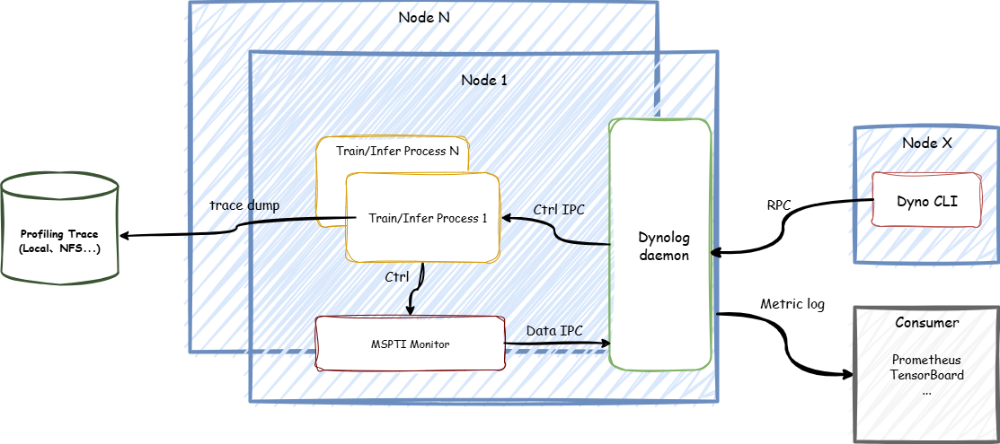

<!-- md-trans-meta sourceCommit=unknown translatedAt=2026-10-26T08:48:40.746Z pushedAt=2026-10-26T09:45:02.214Z -->

<h1 align="center">MindStudio Monitor</h1>

  
<b>Online performance monitoring and dynamic collection tool for Ascend clusters</b>

 
 
 
 
 
 

[English](./README_EN.md) | [简体中文](./README.md)

## ✨ Latest News

- [2025.12.30] The MindStudio Monitor project is fully open-sourced

## ℹ️ Introduction

MindStudio Monitor (`msMonitor`) is an online performance monitoring and dynamic collection tool for Ascend cluster scenarios. Built on [dynolog](https://github.com/facebookincubator/dynolog) (Meta CPU-GPU monitoring system) and [msPTI](https://gitcode.com/Ascend/mspti/blob/master/docs/en/quick_start/mspti_quick_start.md) (MindStudio Profiler Tools Interface), it supports capabilities such as `npu-monitor`, `nputrace`, and `Monitor API`.

Supported framework Profiler tools: [Ascend PyTorch Profiler](https://gitcode.com/Ascend/pytorch/blob/master/docs/en/developer_notes/ascend_pytorch_profiler_user_guide.md) |
[MindSpore Profiler](https://gitcode.com/Ascend/docs/blob/master/MindStudio/master/en/menu/mindspore_profiler_user_guide.md)

The core components are as follows:

| Component | Purpose | Documentation |
| --- | --- | --- |
| `Dynolog daemon` | Server daemon that receives dyno requests and triggers monitoring and collection. | [dynolog](./docs/en/user_guide/dynolog_instruct.md) |
| `Dyno CLI` | Client CLI entry for issuing `npu-monitor` and `nputrace` commands. | [dyno](./docs/en/user_guide/dyno_instruct.md) |
| `msPTI Monitor` | Collection module based on msPTI, responsible for obtaining and reporting performance data. | - |

## ⚙️ Features

msMonitor provides the following core capabilities:

| Feature Name | Description | Documentation |
| --- | --- | --- |
| **npu-monitor** | A lightweight resident background process that continuously monitors the latency of key operators, suitable for observing performance fluctuations online. | [npu-monitor](./docs/en/user_guide/npumonitor_instruct.md) |
| **nputrace** | Dynamically triggers the collection and parsing of performance data from the framework, CANN, and Device sides without interrupting running tasks. | [nputrace](./docs/en/user_guide/nputrace_instruct.md) |
| **Monitor API** | Provides Python interfaces for collecting performance data such as compute operators, communication operators, APIs, Runtime APIs, and Mstx. | [Monitor API](./docs/en/advanced_features/monitor_feature.md) |

> [!note]
>
> Due to underlying resource limitations, `npu-monitor` and `nputrace` cannot be enabled simultaneously.

## 🚀 Quick Start

When using msMonitor for the first time, it is recommended to follow the main path below to complete the end-to-end experience from installation to collection. See Also *[msMonitor Tool Quick Start](./docs/en/quick_start/msmonitor_quick_start.md)*.

## 📦 Installation Guide

The msMonitor tool installation guide includes the following content:

- Install from a downloaded software package: suitable for direct deployment and use, and recommended as the preferred option.
- Install from a compiled software package: suitable for source code debugging, secondary development, and customized builds.
- Upgrade, uninstallation, and logs.

For details, see *[msMonitor Installation Guide](./docs/en/install_guide/msmonitor_install_guide.md)*.

## 📘 Usage Guide

The msMonitor tool provides the following core capabilities: **npu-monitor**, **nputrace**, and **Monitor API**. For detailed usage instructions, see: 
🔹 [npu-monitor instruct](./docs/en/user_guide/npumonitor_instruct.md)  
🔹 [nputrace instruct](./docs/en/user_guide/nputrace_instruct.md)  
🔹 [Monitor API](./docs/en/advanced_features/monitor_feature.md)  

## 💡 Typical Cases

For usage cases of msMonitor in large model training and inference scenarios, see [msMonitor Usage Cases](./docs/en/best_practices/msmonitor_basic_cases.md).

## ❓ FAQ

For common issues and solutions, see *[msMonitor FAQ](./docs/en/support/faq.md)*.

## 🌌 Intelligent Search

To improve document lookup efficiency, we provide multiple efficient search methods:

🔹 [AI Q&A (DeepWiki)](https://deepwiki.com/mindstudio-docs/master): Natural language Q&A to quickly grasp the project architecture and module relationships. 
🔹 [AI Q&A (ZRead)](https://zread.ai/mindstudio-docs/master): Better Chinese Q&A experience, precisely locating feature usage and details. 
🔹 [Precise Search (ReadTheDocs)](https://mindstudio-docs-master.readthedocs.io): Keyword full-text search to directly reach APIs, parameters, and error information. 

## 🛠️ Contribution Guide

You are welcome to contribute to the project. See the [Contribution Guide](./docs/en/contributing/contributing_guide.md).

## ⚖️ Related Notes

🔹 *[Release Notes](https://gitcode.com/Ascend/msmonitor/releases)*  
🔹 *[License Notice](docs/en/legal/license_notice.md)*  
🔹 *[Security Statement](./docs/en/legal/security_statement.md)*  
🔹 *[Disclaimer](./docs/en/legal/disclaimer.md)*  

## 🤝 Suggestions and Communication

Everyone is welcome to contribute to the community. If you have any questions or suggestions, please submit them to [Issues](https://gitcode.com/Ascend/msmonitor/issues), and we will reply as soon as possible. Thank you for your support.

You are cordially invited to participate in the [satisfaction survey](https://rdccucd.wjx.cn/vm/PKPfKqO.aspx) for a chance to win a surprise gift😎.

| 💬 Instant Interaction (WeChat Group) | 📢 Official News (Official Account) | In-depth Support (Assistant/Forum) |
| :---: | :---: | :--- |
|  *Scan the code to join the technical exchange group* |  *Scan the code to follow and get the latest updates* |Scan the code to join the group and follow the official account to reach the fastest communication platform for MindStudio users and developers:  **Quick Questions:** Discuss technical issues with community members in real time **Stay Updated:** Get version release and feature update notifications as soon as possible  **Experience Sharing:** Exchange best practices and hands-on insights with developers   🛠️ **More Support Channels**:👉 Ascend Assistant: 👉 Ascend Forum:  |

## 🙏 Acknowledgments

This tool is jointly contributed by Huawei Technologies Co., Ltd. and developers.

Thank you for every PR from the community. Contributions are welcome!
