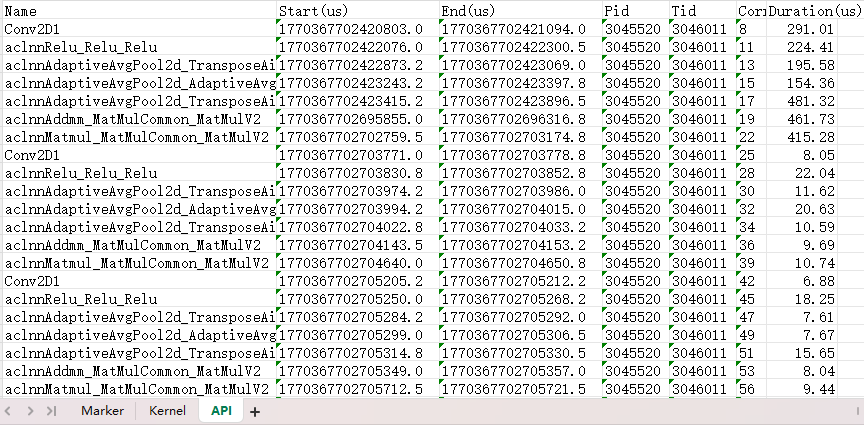

# Monitor Features

## Overview

Monitor is a set of APIs built into MindStudio Monitor. You can call these APIs to start and stop performance monitoring and to obtain the collected data.

## Preparations

Install msMonitor. For details, see the *[msMonitor Installation Guide](../install_guide/msmonitor_install_guide.md)*. Downloading the software package is the recommended installation method.

## Monitor Functions

**Function**

Monitor provides easy-to-use APIs that collect profile data for compute operators, communication operators, APIs, Runtime APIs, and mstx markers, and you can select which data to collect as needed. In addition, Monitor can collect device-level metrics of an NPU card (power and temperature) and metrics for each hardware layer through the DCMI interface, covering AICore frequency and utilization, AICPU maximum and current frequency and utilization, and HBM on-chip memory frequency, capacity, usage, bandwidth, and temperature. The results can be exported in Chrome Trace JSON format, so that you can analyze them by hardware layer in `chrome://tracing` or Perfetto, using duration bars for operators together with counter lines for device metric trends.

**API Description**

For details, see [Monitor Feature APIs](./mindstudio_monitor_api_reference.md#monitor-feature-apis) of mindstudio_monitor.

**Example**

1. Import the Monitor APIs in the model Python script.

   ```python
   from msmonitor import Monitor, ActivityKind, DcmiLayer
   ```

2. Call the Monitor APIs in the model Python script to start performance monitoring.

   ```python
   import torch
   import torch.nn as nn

   class FeatureExtractor(nn.Module):

       def __init__(self, in_channels=3, out_channels=16, kernel_size=3):
           super(FeatureExtractor, self).__init__()
           self.conv = nn.Conv2d(in_channels, out_channels, kernel_size, stride=1, padding=1)
           self.relu = nn.ReLU()
           self.pool = nn.AdaptiveAvgPool2d((4, 4))

       def forward(self, x):
           x = self.conv(x)
           x = self.relu(x)
           x = self.pool(x)
           return x

   from msmonitor import Monitor, ActivityKind, DcmiLayer

   # Start performance monitoring: operator data plus DCMI device metrics.
   # DCMI is configured per hardware layer: selecting a layer collects every
   # metric available for that layer, with no need to enumerate them one by one.
   monitor = Monitor()
   monitor.start(
       kinds=[
           ActivityKind.API,
           ActivityKind.Kernel,
           ActivityKind.Marker
       ],
       dcmi_layers=[
           DcmiLayer.DEVICE,   # Power / Temp
           DcmiLayer.AICORE,   # AICore frequency / utilization family
           DcmiLayer.AICPU,    # AICPU maximum/current frequency, utilization
           DcmiLayer.HBM,      # On-chip memory frequency/capacity/usage/bandwidth/temperature
       ],
       dcmi_interval_ms=10,    # DCMI sampling interval, 10 ms by default
   )

   # Run the model.
   batch_size = 4
   input_tensor = torch.randn(batch_size, 3, 32, 32).npu()
   extractor = FeatureExtractor(in_channels=3, out_channels=16, kernel_size=3).npu()
   linear_layer = nn.Linear(in_features=256, out_features=128).npu()

   for i in range(10):
       range_id = torch.npu.mstx.range_start(f"step {i}", torch.npu.current_stream())
       features = extractor(input_tensor)
       flat_features = features.view(batch_size, -1)
       x = linear_layer(flat_features)
       w = torch.randn(128, 64).npu()
       y = torch.matmul(x, w)
       torch.npu.mstx.range_end(range_id)

   torch.npu.synchronize()

   # Stop performance monitoring.
   monitor.stop()

   # (Optional) Obtain the profile data online. See step 3.
   result = monitor.get_result()

   # (Optional) Save the profile data locally. start has already fixed the output
   # directory, and the argument-free save exports xlsx/json/log. See step 4.
   monitor.save()
   ```

3. (Optional) Obtain the profile data online. For the returned data structure, see [ActivityData Data Structure](./mindstudio_monitor_api_reference.md#activitydata-data-structure). The keys of the returned dictionary are the enabled `ActivityKind` values plus a DCMI sample list, which is always keyed `DCMI`; each element is a `DcmiSample` whose fields are the metric kind, timestamp, device ID, and value.

   ```python
   # Obtain and print the profile data.
   result = monitor.get_result()
   for kind, data in result.items():
       for item in data:
           print(f"kind: {kind}, name: {item.name}, durationNs: {item.endNs-item.startNs}")
   ```

4. (Optional) Save the profile data locally. `save()` takes no arguments and exports to the output directory that was already fixed by `start(save_path=...)`: `start` creates the session directory `msmonitor_<pid>_<timestamp>/` under that path, glog writes directly into its `log/` from the very beginning, and `save` only adds the xlsx and json files without moving or copying anything:

   ```python
   # Specify the output directory at start (the session directory is created directly under it).
   monitor.start(..., save_path="./out")
   # Export: ./out/msmonitor_<pid>_<timestamp>/monitor_result.xlsx + monitor_result.json + log/
   monitor.save()
   ```

   > Omit `save_path` when the data is only to be obtained online, without writing to disk: `start(..., save_path=None)` creates no session directory and writes no log file, and the data is read from memory through `get_result()`. Calling `save()` in this case reports that no session directory exists.

   - `monitor_result.xlsx`: An Excel workbook with multiple sheets, including sheets for operator durations and for DCMI metrics.
   - `monitor_result.json`: Chrome Trace JSON that can be opened in `chrome://tracing` or Perfetto. Operator durations are rendered as bars (X events) and DCMI metrics as counter lines (C counter events), presented per hardware layer in separate processes.
   - `log/` subdirectory: The C++ glog runtime log of the current process. glog writes into it from the moment `start()` is called; there is no outer temporary log directory.

   > For an end-to-end example, see the system test [`test/st/test_dcmi_fa_comm_multistream.py`](../../../test/st/test_dcmi_fa_comm_multistream.py) (multi-stream FA compute + DCMI collection + export verification).

## Output File Description

The Excel file written to disk contains multiple sheets, and each sheet corresponds to one collected data type, such as API, Kernel, or Marker. You can inspect the different sheets to analyze the execution duration of operators and APIs.

See the following figure.



The fields of each sheet are described as follows:

### Marker

* `Name`: Content of the mstx marker message
* `SourceKind`: Message source type, either `Host` or `Device`
* `Domain`: Name of the domain to which the message belongs
* `ID`: Message ID
* `Start(us)`: mstx marker start time, in microseconds
* `End(us)`: mstx marker end time, in microseconds
* `Pid`: Process ID when `SourceKind` is `Host`, or `0` when `SourceKind` is `Device`
* `Tid`: Thread ID when `SourceKind` is `Host`, or `0` when `SourceKind` is `Device`
* `Device ID`: ID of the device to which the marker belongs when `SourceKind` is `Device`, or `0` when `SourceKind` is `Host`
* `Stream ID`: ID of the stream to which the marker belongs when `SourceKind` is `Device`, or `0` when `SourceKind` is `Host`
* `Duration(us)`: Duration of the mstx marker, in microseconds

### Kernel

* `Name`: Name of the compute operator
* `Start(us)`: Operator execution start time, in microseconds
* `End(us)`: Operator execution end time, in microseconds
* `Device ID`: ID of the device where the operator is executed
* `Stream ID`: ID of the stream where the operator is executed
* `Correlation ID`: Operator correlation ID, used to associate the operator with API data
* `Type`: Operator type, for example, `KERNEL_AICORE`, `KERNEL_AIVEC`, or `KERNEL_AICPU`
* `Duration(us)`: Operator execution duration, in microseconds

### Communication

* `Name`: Name of the communication operator
* `Start(us)`: Operator execution start time, in microseconds
* `End(us)`: Operator execution end time, in microseconds
* `Device ID`: ID of the device where the operator is executed
* `Stream ID`: ID of the stream where the operator is executed
* `Count`: Volume of data transferred by the operator
* `DataType`: Data type transferred by the operator, for example, `FP32` or `INT8`
* `CommName`: Name of the communication domain to which the operator belongs
* `AlgType`: Communication algorithm used by the operator, for example, `RING` or `MESH`
* `Correlation ID`: Operator correlation ID, used to associate the operator with API data
* `Duration(us)`: Operator execution duration, in microseconds

### API, AclAPI, NodeAPI, and RuntimeAPI

* `Name`: API name
* `Start(us)`: API call start time, in microseconds
* `End(us)`: API call end time, in microseconds
* `Pid`: ID of the process that calls the API
* `Tid`: ID of the thread that calls the API
* `Correlation ID`: API call correlation ID, used to associate the API with Kernel/Communication data
* `Duration(us)`: API call duration, in microseconds

### DCMI

When `dcmi_layers` is specified in `start`, the workbook gains an additional `DCMI` sheet.

Each row of the `DCMI` sheet corresponds to one DCMI sample, with all devices and all metrics flattened:

* `Layer`: Hardware layer to which the metric belongs, one of `DEVICE`, `AICORE`, `AICPU`, or `HBM`
* `Metric`: Metric name, such as `Power`, `AICore Freq`, `AICPU Max Freq`, or `HBM Memory Used`
* `Unit`: Metric unit, such as `W`, `MHz`, `%`, `MB`, or `℃`
* `Timestamp(us)`: Sampling timestamp, in microseconds
* `Device ID`: Device ID (flattened index)
* `Value`: Sampled value

### Chrome Trace (.json)

The Chrome Trace JSON produced by `save()` (inside the `out/msmonitor_<pid>_<timestamp>/` folder fixed by `start(save_path)`) can be opened in `chrome://tracing` or Perfetto (`ui.perfetto.dev`). Events are presented per hardware layer in separate processes, with six processes per device and process names such as `Device 0 · Ascend Hardware`:

| Layer | Content | Presentation |
|---|---|---|
| Ascend Hardware | Kernel/Communication duration bars collected by mspti, one lane per stream | Bars (X events) |
| Power/Temp | DEVICE-layer metrics (power and temperature) | Lines (C events) |
| AICore | AICore current and rated frequency, and utilization (including AI Cube, Vector Core, and NPU utilization) | Lines |
| AICPU | AICPU maximum and current operating frequency, and utilization | Lines |
| HBM | On-chip memory frequency, total capacity, used memory, bandwidth utilization, and temperature | Lines |
| Overlap Analysis | One lane per device: Computing / Communication (Overlapped / Not Overlapped) / Free | Duration bars |

DCMI collection runs in a dedicated C++ thread and does not block the training main flow. The default sampling interval is 10 ms, and samples are held in a bounded ring buffer with a cap of 1,000,000 entries that overwrites the oldest entry once the cap is exceeded. If `libdcmi.so` is unavailable or an interface is not supported, the corresponding metrics are skipped automatically without affecting operator data collection. DFX information about loading, enabling, and failures is printed to the startup log and also written to the trace metadata (visible after the Chrome Trace is opened) for troubleshooting.
