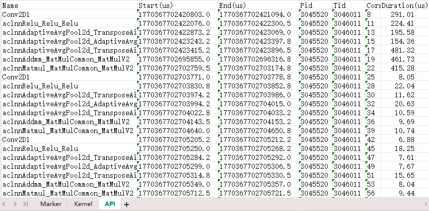

# Monitor Features

## Overview

Monitor is a set of APIs integrated in MindStudio Monitor. You can call these APIs to start and stop performance monitoring and obtain monitoring data.

## Preparations

Install msMonitor. For details, see [msMonitor Installation Guide](../install_guide/msmonitor_install_guide.md). You are advised to download the software package for installation.

## Monitor Functions

**Function**

Provides simple and easy-to-use interfaces for collecting performance data such as compute operators, communication operators, APIs, Runtime APIs, and Mstx. You can select the metrics to collect as needed. In addition, it supports collecting device-level metrics (Power, Temp) of the NPU card and metrics of each hardware layer (AICore frequency/utilization, AICPU maximum/current frequency and utilization, HBM on-chip memory frequency/capacity/usage/bandwidth/temperature, etc.) through the DCMI interface, and supports exporting the results in Chrome Trace JSON format for visualization and analysis by hardware layer in the form of timeline bar charts (operator duration) plus curves (device metric change trends) in `chrome://tracing` or Perfetto.

**API Description**

For details, see [Monitor Feature APIs](./mindstudio_monitor_api_reference.md#monitor-feature-apis) for mindstudio_monitor.

**Example**

1. Import the Monitor APIs to the model Python script.

   ```python
   from msmonitor import Monitor, ActivityKind, DcmiLayer
   ```

2. Call the Monitor APIs in the model Python script to start performance monitoring.

   ```python
   import torch
   import torch.nn as nn

   class FeatureExtractor(nn.Module):

       def __init__(self, in_channels=3, out_channels=16, kernel_size=3):
           super(FeatureExtractor, self).__init__()
           self.conv = nn.Conv2d(in_channels, out_channels, kernel_size, stride=1, padding=1)
           self.relu = nn.ReLU()
           self.pool = nn.AdaptiveAvgPool2d((4, 4))

       def forward(self, x):
           x = self.conv(x)
           x = self.relu(x)
           x = self.pool(x)
           return x

   from msmonitor import Monitor, ActivityKind, DcmiLayer

   # Enable performance monitoring: operator-type data + DCMI device metrics
   # DCMI is configured by hardware layer: selecting a layer collects all available metrics of that layer (no need to enumerate them one by one).
   monitor = Monitor()
   monitor.start(
       kinds=[
           ActivityKind.API,
           ActivityKind.Kernel,
           ActivityKind.Marker
       ],
       dcmi_layers=[
           DcmiLayer.DEVICE,   # Power / Temp
           DcmiLayer.AICORE,   # AICore frequency / utilization group
           DcmiLayer.AICPU,    # AICPU maximum/current frequency, utilization
           DcmiLayer.HBM,      # On-chip memory frequency/capacity/usage/bandwidth/temperature
       ],
       dcmi_interval_ms=10,    # DCMI sampling interval, default 10ms
   )

   # Run the model.
   batch_size = 4
   input_tensor = torch.randn(batch_size, 3, 32, 32).npu()
   extractor = FeatureExtractor(in_channels=3, out_channels=16, kernel_size=3).npu()
   linear_layer = nn.Linear(in_features=256, out_features=128).npu()

   for i in range(10):
       range_id = torch.npu.mstx.range_start(f"step {i}", torch.npu.current_stream())
       features = extractor(input_tensor)
       flat_features = features.view(batch_size, -1)
       x = linear_layer(flat_features)
       w = torch.randn(128, 64).npu()
       y = torch.matmul(x, w)
       torch.npu.mstx.range_end(range_id)

   torch.npu.synchronize()

   # Stop performance monitoring.
   monitor.stop()

   # (Optional) Obtain profile data online. For details, see step 3.
   result = monitor.get_result()

   # (Optional) Save performance data to the local host (the output directory has been specified in start; save exports xlsx/json/log without parameters); see step 4
   monitor.save()
   ```

3. (Optional) Performance data can be obtained online. For the returned data structure, see [ActivityData Data Structure](./mindstudio_monitor_api_reference.md#activitydata-data-structure). The keys of the returned dictionary include the enabled `ActivityKind` and a DCMI sample list (uniformly using `DCMI` as the key, with elements of `DcmiSample`, whose fields include the metric kind, timestamp, device ID, and value).

   ```python
   # Obtain and print profile data.
   result = monitor.get_result()
   for kind, data in result.items():
       for item in data:
           print(f"kind: {kind}, name: {item.name}, durationNs: {item.endNs-item.startNs}")
   ```

4. (Optional) Save performance data to the local host: `save()` exports without parameters, and the output directory is already determined when `start(save_path=...)` is called — start creates the `msmonitor_<pid>_<timestamp>/` session directory under it, glog writes directly into its `log/` from the beginning, and save only supplements xlsx/json, with no moving or copying at all:

   ```python
   # Specify the output directory at start (the session directory is created directly under it)
   monitor.start(..., save_path="./out")
   # Export: ./out/msmonitor_<pid>_<timestamp>/monitor_result.xlsx + monitor_result.json + log/
   monitor.save()
   ```

   > When only obtaining data online (without persistence), omit `save_path`: `start(..., save_path=None)` does not create a session directory
   > and does not save log files; obtain data directly through `get_result()` in memory. In this case, calling `save()` prompts that there is no session directory.

   - `monitor_result.xlsx`: Excel (multiple sheets, including operator duration and DCMI metric sheets).
   - `monitor_result.json`: Chrome Trace JSON, which can be opened in `chrome://tracing` or Perfetto. Operator durations are presented as bar charts (X events) and DCMI metrics as curves (C counter events), by hardware layer in separate processes.
   - `log/` subdirectory: C++ glog running logs of the current process. From `start()`, glog writes into it (there is no outer temporary log directory).

   > For an end-to-end running example, see the system test case [`test/st/test_dcmi_fa_comm_multistream.py`](../../../test/st/test_dcmi_fa_comm_multistream.py) (FA multi-stream computation + DCMI collection + export verification).

## Output File Description

The output Excel file contains multiple sheets. Each sheet corresponds to a data type, such as API, kernel, and marker. You can view different sheets to analyze the execution time of operators and APIs.

See the following figure.



The fields on each sheet are described as follows:

### Marker

* `Name`: mstx dotting message content
* `SourceKind`: message source type, either `Host` or `Device`
* `Domain`: name of the domain to which the message belongs
* `ID`: message ID
* `Start(us)`: mstx dotting start time, in microseconds
* `End(us)`: mstx dotting end time, in microseconds
* `Pid`: process ID when `SourceKind` is `Host`, and `0` when `SourceKind` is `Device`
* `Tid`: thread ID when `SourceKind` is `Host`, and `0` when `SourceKind` is `Device`
* `Device ID`: ID of the device to which the marker belongs when `SourceKind` is `Device`, or `0` when `SourceKind` is `Host`
* `Stream ID`: ID of the stream to which the marker belongs when `SourceKind` is `Device`, or `0` when `SourceKind` is `Host`
* `Duration(us)`: mstx dotting execution time, in microseconds

### Kernel

* `Name`: name of a compute operator
* `Start(us)`: operator execution start time, in microseconds
* `End(us)`: operator execution end time, in microseconds
* `Device ID`: ID of the device where the operator is executed
* `Stream ID`: ID of the stream where the operator is executed
* `Correlation ID`: operator execution correlation ID, which is used to associate with API data
* `Type`: operator type, for example, `KERNEL_AICORE`, `KERNEL_AIVEC`, or `KERNEL_AICPU`
* `Duration(us)`: operator execution time, in microseconds

### Communication

* `Name`: name of a communication operator
* `Start(us)`: operator execution start time, in microseconds
* `End(us)`: operator execution end time, in microseconds
* `Device ID`: ID of the device where the operator is executed
* `Stream ID`: ID of the stream where the operator is executed
* `Count`: data volume transmitted by the operator
* `DataType`: data type transmitted by the operator, for example, `FP32` or `INT8`
* `CommName`: name of the communicator to which the operator belongs
* `AlgType`: communication algorithm type of the operator, for example, `RING` or `MESH`
* `Correlation ID`: operator execution correlation ID, which is used to associate with API data
* `Duration(us)`: operator execution time, in microseconds

### API, AclAPI, NodeAPI, and RuntimeAPI

* `Name`: API name
* `Start(us)`: API call start time, in microseconds
* `End(us)`: API call end time, in microseconds
* `Pid`: ID of the process that calls the API
* `Tid`: ID of the thread that calls the API
* `Correlation ID`: API call correlation ID, which is used to associate with kernel/communication data
* `Duration(us)`: API call duration, in microseconds

### DCMI

When `dcmi_layers` is specified in `start`, the Excel file has an additional `DCMI` sheet.

Each row of the `DCMI` sheet corresponds to one DCMI sampling sample (all devices x all metrics arranged in a flat manner):

* `Layer`: Hardware layer to which the metric belongs, with values `DEVICE` / `AICORE` / `AICPU` / `HBM`
* `Metric`: Metric name, such as `Power`, `AICore Freq`, `AICPU Max Freq`, or `HBM Memory Used`
* `Unit`: Metric unit, such as `W`, `MHz`, `%`, `MB`, or `℃`
* `Timestamp(us)`: Sampling timestamp, unit: us
* `Device ID`: Device ID (flat index)
* `Value`: Sampling value

### Chrome Trace (.json)

The Chrome Trace JSON generated by `save()` (located in the `out/msmonitor_<pid>_<timestamp>/` folder determined by `start(save_path)`) can be opened in `chrome://tracing` or Perfetto (`ui.perfetto.dev`). Events are presented by hardware layer in separate processes (6 processes per device, with process names such as `Device 0 · Ascend Hardware`):

| Layer | Content | Presentation |
|---|---|---|
| Ascend Hardware | Kernel / Communication duration bars collected by mspti, one lane per stream | Bar chart (X events) |
| Power/Temp | DEVICE layer metrics (Power/Temp) curves | Curves (C events) |
| AICore | AICore current/rated frequency and utilization (including AI Cube / Vector Core / NPU utilization) | Curves |
| AICPU | AICPU maximum/current running frequency and utilization | Curves |
| HBM | On-chip memory frequency, total capacity, used memory, bandwidth utilization, temperature | Curves |
| Overlap Analysis | One lane per device: Computing / Communication (Overlapped / Not Overlapped) / Free | Duration bars |

DCMI collection is executed in an independent C++ thread and does not block the main training process. The default sampling interval is 10ms, and samples use a bounded ring buffer (with an upper limit of 1 million entries, overwriting the oldest when exceeded). When `libdcmi.so` is unavailable or the interface is not supported, the corresponding metrics are automatically skipped without affecting operator-type data collection. DFX information about loading, enabling, and failures is printed in the startup log and written into the trace metadata (viewable after the Chrome Trace is opened) for problem localization.
