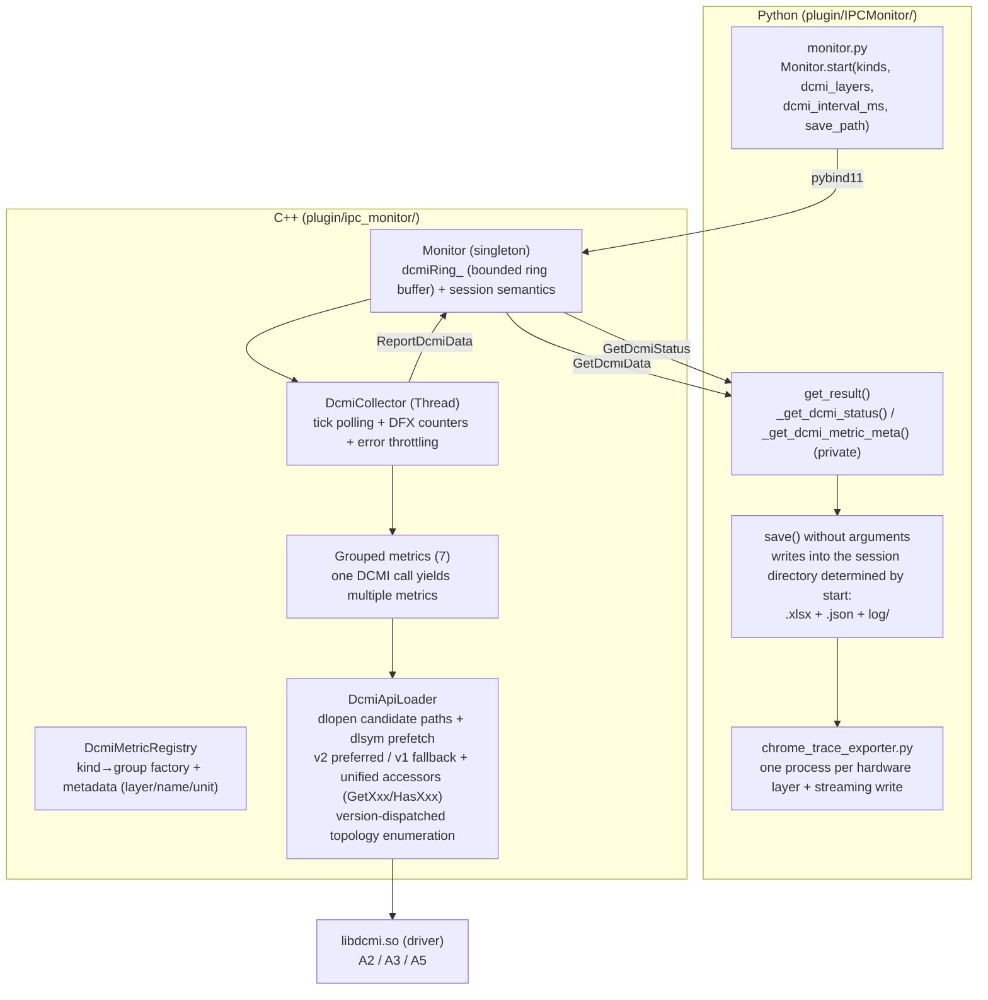
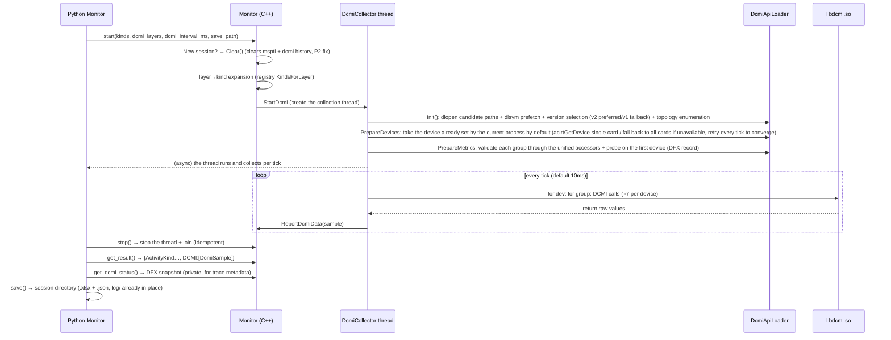
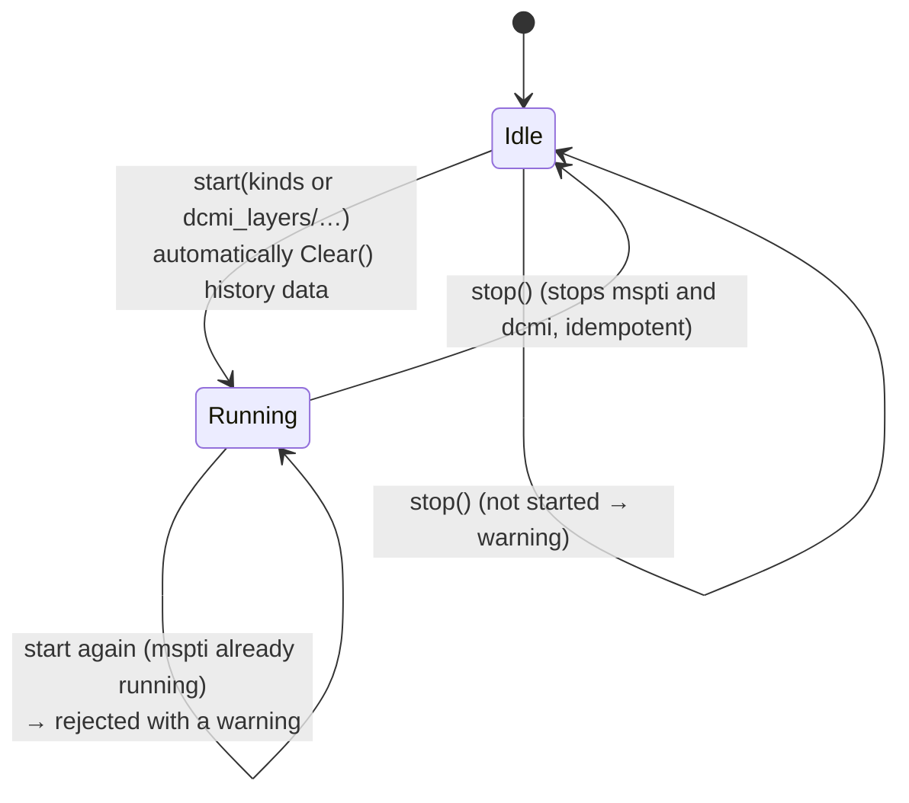
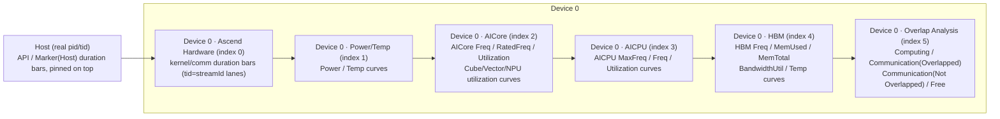
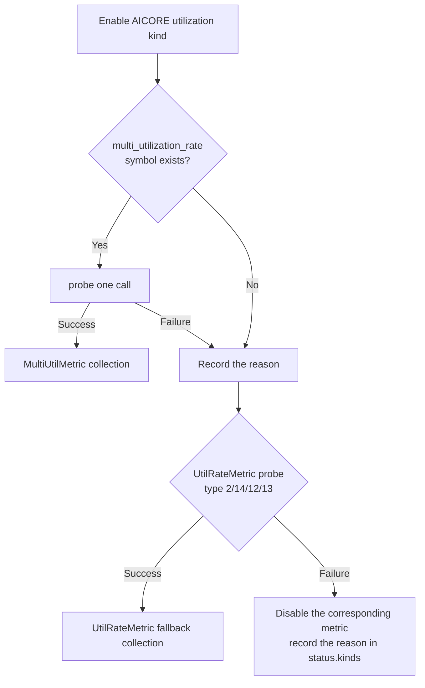
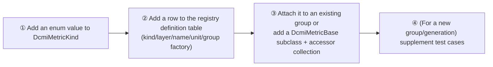

# msmonitor DCMI Collection + Chrome Trace Layered Visualization Technical Design (RFC)

**Status**: Draft

**Authors**: @kali20gakki1

**Created**: 2026-08-22

**Updated**: 2026-08-31

**Related issue/PR**: Reference implementation [Ascend/msmonitor !133 (support dcmi collect)](https://gitcode.com/Ascend/msmonitor/pull/133) (this proposal is a redesign based on the review comments for that pull request)

---

# 1. Overview

## 1.1 Introduction

This proposal adds two capabilities to the Monitor API (`plugin/IPCMonitor/`) built into the `msmonitor` whl package:

1. **DCMI hardware metric collection**: A dedicated C++ thread dynamically loads `libdcmi.so` through `dlopen` to collect device-level NPU metrics (power/temperature) and metrics of each hardware layer (AICore frequency and utilization, AICPU maximum/current frequency and utilization, and HBM on-chip memory frequency/capacity/usage/bandwidth utilization/temperature). The Python API configures collection items **by hardware layer (DEVICE/AICORE/AICPU/HBM)** and configures them together with the existing `ActivityKind` in `Monitor.start()`.
2. **Chrome Trace JSON visualization export**: `Monitor.start(..., save_path)` determines the session directory `<save_path>/msmonitor_<pid>_<timestamp>/` (glog writes into its `log/` directly from the start). `Monitor.save()` takes no arguments and exports within it, generating a Chrome Trace JSON and an Excel file (`monitor_result.json` can be opened in `chrome://tracing` or Perfetto; kernel/comm duration bars (X events) and DCMI metric curves (C counter events) are presented **in separate processes by hardware layer**, and kernels are split into lanes by stream), with no move/copy and no outer temporary log directory.

Core value: present "operator duration (software view)" and "hardware state (power/frequency/utilization, hardware view)" aligned on the **same timeline**, helping locate whether the training/inference performance bottleneck is "the operator itself is slow" or "the hardware is being throttled/limited/bandwidth-saturated".

## 1.2 Motivation

- **Current pain points**: The current Monitor can collect only mspti operator-level data (Kernel/Communication/API/Marker) and cannot answer questions such as "what is the hardware frequency, how high is the power, is the HBM bandwidth saturated, and has the AICPU become the bottleneck while operators are running". To troubleshoot performance problems, developers must sample manually with commands such as `npu-smi`, which cannot be aligned with the operator timeline.
- **User scenarios**:
  - Training/inference performance analysis: Enable collection with one click in vLLM or PyTorch training scripts, and after the run view the kernel lanes together with the AICore frequency/utilization curves in Perfetto to determine whether DVFS throttling occurs or whether the HBM bandwidth is saturated.
  - Hardware health/trend observation: Collect power/temp curves over a long period to observe power ramp-up and temperature trends (stress test scenarios).
  - Fault locating: Exceptions such as a missing `libdcmi.so`, an unsupported interface (generation differences), or an error returned by a call must be traceable through explicit DFX means instead of failing silently.
- **Necessity**: The DCMI interface is the only unified device-level metric interface for Ascend hardware, and the official documentation covers all generations from A2/A3 to the central training card (A5/950). Without this proposal, the hardware view capability of Monitor would be missing for a long time.
- **Impact of not doing it**: Users continue to rely on manual `npu-smi` sampling, which cannot be aligned with the operator timeline, resulting in low troubleshooting efficiency.

## 1.3 Objectives

**Objectives**:

- G1: DCMI is collected by a dedicated C++ thread, and the Python API configures collection items by hardware layer. The collection overhead is minimal (all layers: about 7 DCMI calls and about 16 samples per device per tick).
- G2: The Monitor interface configures both the existing `ActivityKind` and the new `DcmiLayer` in a unified way.
- G3: Export supports both Excel and Chrome Trace (dcmi curves, kernel/comm duration bars), presented in separate processes by hardware layer.
- G4: The DCMI module is easy to extend (registry + grouped metric abstraction; adding a metric requires no changes to the Collector/Exporter).
- G5: Complete DFX: failure to load the so, missing symbols, and errors returned by interfaces all have locating means (startup log summary + status embedded in trace metadata).
- G6: Compatible with A2 / A3 / A5 (950) generation chips: **DCMI v2 preferred with automatic v1 fallback** (a v1-only library uses v1 directly, and a v2-only library uses v2), automatically adapting to the number of NPU chips per card and to interface differences.

# 2. Use Case Analysis

## 2.1 Use Case List

| ID | Use case | Description | Key performance indicator | DFX requirement |
|---|---|---|---|---|
| UC1 | Joint training/inference performance analysis | Collect Kernel/Communication + DCMI of all hardware layers, and export Chrome Trace for viewing on the same timeline | A sampling interval of ≤10ms does not affect the main training flow; the exported file can be opened by Perfetto normally | Collection exceptions do not interrupt training; the trace is self-describing (metadata contains DFX status) |
| UC2 | Hardware trend/stress test observation | Collect only DCMI (run operators under high load) and observe power/temp/freq/bandwidth curves | 10ms-level sampling; the ring is bounded and does not cause OOM | Overflow/timeout is visible (`ringDropCount`/`overrunCount`) |
| UC3 | Tabular analysis | Excel export: DCMI samples + DFX status sheets, facilitating scripted/manual analysis | Millions of samples can be exported | The DCMI sheet contains layers/units, and the status sheet contains load and enablement information |
| UC4 | Fault locating | Quickly locate a missing `libdcmi.so`, missing symbols, unsupported interfaces, or an error returned by a call | Error logs are throttled and do not flood the console | The startup log summarizes the load status, missing symbols, enablement reason, and failure count; these are written into trace metadata |
| UC5 | Multi-generation deployment | The same whl runs on A2 / A3 / A5 | Automatic adaptation without manual configuration | Unsupported types are automatically disabled with a reason |

## 2.2 Usage Limits and Constraints

| Constraint | Description |
|---|---|
| Runtime environment | Linux only (depends on `dlopen`/`pthread`); the NPU driver is installed and `libdcmi.so` can be loaded (LD_LIBRARY_PATH and fixed candidate paths are searched by default) |
| Permissions | Both root and non-root users are supported on a bare-metal server (per the official support matrix); container scenarios require root and some interfaces are unsupported (for example, the bandwidth utilization in an AVI container is 0) |
| Generation differences | A2/A3 support utilization types 2,3,4,6,10,12,13,14; A5 (training card) supports 1,2,3,4,5,6,10. Unsupported metrics are automatically disabled with a prompt |
| Sampling and storage | Default interval 10ms; the sample ring buffer holds a fixed 1,000,000 entries (internal policy, overwriting the oldest). Long runs with high sampling rates cause ring overwriting or a large trace file, so increase the interval according to the scenario |
| Data security | Only public device-level metrics are collected (power/frequency/temperature/utilization/memory); user data, operator input arguments, weights, and the like are not collected |

# 3. Solution Design

## 3.1 Overall Solution

### 3.1.1 Overall Architecture



### 3.1.2 Data Link (Sequence)



### 3.1.3 Session Semantics (State Machine)



### 3.1.4 Chrome Trace Layered Presentation

Each device is presented as 6 processes in the trace (`pid = 1_000_000 + device number×6 + index`, `process_sort_index`: Host=0 pinned on top, devices at 1000+index; Host uses the real pid):



## 3.2 Technology Selection

| Option | Alternative | Choice | Comparison conclusion |
|---|---|---|---|
| DCMI access method | A: Link DCMI headers/libraries at compile time | **B: Dynamic loading through `dlopen`/`dlsym`** | A depends on the driver development kit and is strongly bound to the driver version; B has no compile-time dependency, can degrade when symbols are missing, and incurs zero parsing overhead during collection (dlsym is prefetched once), aligning with the CANN `prof_timer` pattern |
| Python configuration model | A: Flat `DcmiMetricKind` enumeration (17 items) selected one by one | **B: Configuration by hardware layer `DcmiLayer`** | A has many items and is disconnected from the underlying fact that "one interface returns multiple metrics of the same layer"; in B, a layer naturally corresponds to an interface (the HBM layer ↔ `hbm_info`), so selecting a layer collects everything, with less configuration and predictable overhead |
| Collection call model | A: One DCMI call per metric (3 items = 3 calls) | **B: Grouped metrics; one interface call yields multiple kinds** | In A the number of calls grows linearly with the number of metrics; in B each layer needs ≤2 calls (the struct API returns values in batches), and all layers need only about 7 calls |
| Utilization collection | A: Only `dcmi_get_device_utilization_rate` type by type | **B: Prefer `multi_utilization_rate` (one call returns 4 items), and degrade to A if missing or failed** | B uses fewer calls; the degradation path is decided automatically by the probe, adapting to generation differences |
| Sample storage | A: Unbounded vector | **B: Bounded ring buffer (default 1M, overwriting the oldest when full)** | A runs out of memory on long runs; B has bounded memory and counts overflows (DFX) |
| Export implementation location | A: Generated in C++ | **B: Python (`chrome_trace_exporter.py`)** | The data has already been passed to Python through pybind, and Excel export is already in Python; B keeps C++ lightweight, reuses the existing file management, and controls memory through streaming writes |
| Thread model | A: One thread per device | **B: A single thread polls all devices × metrics** | Aligns with `prof_timer`; 7 calls per device per tick is well within budget at the default 10ms tick, timeouts degrade automatically, and thread explosion is avoided |
| Enumeration extension | A: Extend the third-party `msptiActivityKind` | **B: Independent `DcmiLayer`/`DcmiMetricKind`** | The mspti enumeration cannot be changed; an independent enumeration plus registry metadata provides a single source of truth |
| Version strategy | A: v1 only (the PR !133 approach) | **B: v2 preferred + automatic v1 fallback** | 950 is v2-only (v1 init returns -8255); 910B has no dcmiv2 symbols and uses v1 automatically; new drivers such as those on A3 have both stacks and use v2 automatically. Preferring v2 is correct and forward-looking for all three generations |
| Generation dispatch location | A: `if (v2) ... else ...` inside each metric | **B: Unified accessors in `DcmiApiLoader` (`GetXxx`/`HasXxx`)** | Dispatch converges in one place in the loader, and the metric layer has no generation branches; adding a DCMI version or interface only requires changing the loader |

## 3.3 Function and Performance Design

### 3.3.1 Function Points

| Function | Description |
|---|---|
| Layer configuration expansion | `Monitor.start(dcmi_layers=...)` → the C++ registry `KindsForLayer(layer)` expands the layers into a set of kinds |
| Collection | Collection by a dedicated thread per tick; the devices parameter is not exposed, and the device already set by the current process is used by default (`aclrtGetDevice`); if it cannot be obtained, all visible cards are used and convergence to a single card is retried every tick |
| Version adaptation | `DcmiApiLoader` prefers v2 (`dcmiv2_init` + `dcmiv2_get_device_list`) and falls back to v1 automatically when symbols are missing or init/enumeration fails; failures are reported with merged reasons (DFX) |
| Degradation | Multiple interfaces/types are probed item by item through the unified accessors; unsupported metrics are automatically disabled with the reason recorded; when `multi_utilization` is missing, UtilRate falls back to type-by-type collection |
| Export | `.xlsx` (DCMI sheets) and `.json` (Chrome Trace layers + Overlap Analysis) |
| DFX | The status snapshot (including version and the time consumed by each interface) is provided to trace metadata through the private `_get_dcmi_status()`; error logs are throttled; a summary log is printed on stop; metrics that cannot be collected are reported at startup |

### 3.3.2 Data Model

**DcmiSample** (one sample per row):

| Field | Type | Description |
|---|---|---|
| kind | DcmiMetricKind | Metric type |
| timestampNs | uint64 | Sampling timestamp (ns) |
| deviceId | int32 | Flat device ID |
| value | double | Sampled value (the unit is defined in the registry metadata) |

**DcmiMetricMeta** (maintained by the registry, the single source of truth for Python export/DFX):

| Field | Description |
|---|---|
| kind / layer | Metric type / hardware layer it belongs to |
| name / displayName | Enumeration name / display name (for example, `AICore Freq`) |
| unit | Unit (`W`/`MHz`/`%`/`MB`/`℃`) |

**DcmiStatusSnapshot** (returned by the private `_get_dcmi_status()`, DFX):

| Field | Description |
|---|---|
| load | Load status (statusName, matched path, missing symbols, dcmi_init return code, number of cards/chips per card, collection device list, error reason) |
| kinds | Enablement status and the reason for not being enabled for each metric |
| tickCount / overrunCount | Number of ticks / number of timeouts (automatic throttling on timeout) |
| ringDropCount / ringSize / ringCapacity | Number of ring full-overwrites / current number of samples / capacity |
| groupFailCounts / lastErrorCodes | Number of failed calls for each interface / latest error codes |

### 3.3.3 Performance Design

**Per-device per-tick call overhead** (16 metrics across all layers):

| Group | DCMI call | Number of kinds produced | Unit |
|---|---|---|---|
| PowerMetric | `power_info` | 1 | W (×0.1) |
| TempMetric | `temperature` | 1 | ℃ |
| AicoreInfoMetric | `aicore_info` | 2 | MHz |
| MultiUtilMetric | `multi_utilization_rate` | 4 | % |
| AicpuInfoMetric | `aicpu_info` | 2 | MHz |
| UtilRateMetric | `utilization_rate`(type=3) | 1 | % |
| HbmInfoMetric | `hbm_info` | 5 | MB/MHz/%/℃ |
| **Total** | **≈7 calls** | **≈16 samples** | |

**Overhead budget** (a DCMI ioctl typically takes ≤50μs per call, referring to the measured `prof_timer`; **on real hardware, utilization_rate can take ~36ms per call**):

| Scenario | Calls per tick | Estimated duration | Conclusion |
|---|---|---|---|
| Single device × all layers | 7 | ≤350μs (controlled within budget through throttling when the util interface is slow) | A 1ms tick is feasible |
| 8 devices × all layers | 56 | ≥2.8ms (up to 1.5s when util is slow) | Automatic throttling on timeout + **automatic convergence to a single card** + **slow-interface throttling** |
| Single device × single layer (for example, HBM only) | 1~2 | ≤100μs | A 1ms tick is sufficient |

**Real-hardware measurements and countermeasures (2026-08-22 to 08-24, 910B and 950 servers)**:

- 910B (v1-only): a single `dcmi_get_device_utilization_rate` call takes about 36ms (driver behavior), and the `libdcmi.so` on that machine is missing the `dcmi_get_device_multi_utilization_rate` symbol → utilization requires 5 type-by-type calls → 8 devices × 5 = 40 calls per tick ≈ 1.46s, accounting for 92% of the tick.
- 950 (v2-only): the entire v1 pipeline returns -8255; after v2 takes effect, struct interfaces such as `multi_utilization_rate`/`hbm_info` return multiple values in one call, and **all 16 metrics are available**, without the type-by-type utilization problem of 910B; `utilization_rate` (AICPUUtil) is also relatively slow (~36ms per call), so throttling continues to apply.
- Countermeasure 1 (**slow-interface throttling**): `DcmiMetricBase::SampleEveryTicks()` reduces the frequency by group; UtilRateMetric collects once every 10 ticks by default, bringing the per-tick budget back to the millisecond level.
- Countermeasure 2 (**automatic convergence to a single card**): the devices parameter is not exposed; if `aclrtGetDevice` cannot obtain the current device at startup (start happens before torch set_device), all cards are used first, and the collection thread **retries every tick**; once the current device is obtained, it converges to a single card.
- Countermeasure 3 (**final sampling**): a final sample is added when stop is called (bypassing the slow-interface throttling gate), ensuring that the curves cover the stop moment and overlap the tail of the kernel window.
- Countermeasure 4 (DFX loop closure): the collector status is retained after stop and remains readable through the private `_get_dcmi_status()`, and is written into trace metadata; `version/groupCallCounts/groupCollectNs/lastTickCollectUs` allows verifying the time consumed by each interface and whether throttling takes effect.
- Countermeasure 5 (**the timestamp of the final sampling tick is taken when collection completes**): samples of ordinary ticks use the tick start time (so that the start points of the metrics in the same tick are aligned); only the final tick is timestamped after collection completes, preventing a slow interface (utilization_rate can take hundreds of ms) from making the last sample earlier than the real stop moment and leaving a hole at the end of the timeline (fixed in two rounds of real-hardware tests on 2026-08-31: timestamping per group first misaligned the start points of the metrics, which was then narrowed down to timestamping at the end of the tick only for the final tick); together with examples that synchronize all computation streams before stop, the tail of the DCMI curves overlaps the kernel window.

**Memory budget**:

| Item | Budget |
|---|---|
| Ring capacity default 1,000,000 × DcmiSample (≈32B) | ≈32MB (overwrites the oldest, bounded) |
| Exported JSON (1M samples × ≈90B) | ≈90MB worst case (streaming write, no full-tree residency) |

**Throttling mechanism**: If the tick is already overdue at its start, `nextNs = now + interval` (no catch-up) and `overrunCount++`, ensuring that the collection thread does not accumulate burst catch-up collections.

### 3.3.4 Boundary Scenario Design

| Boundary scenario | Behavior | Verification point |
|---|---|---|
| `libdcmi.so` missing/unloadable | `Init()` returns NOT_SUPPORT, one `LOG(WARNING)` is printed, DCMI is disabled as a whole, and operator-level collection is unaffected | status.load.statusName=NOT_SUPPORT + the error is readable |
| v1-only library (910B, no dcmiv2 symbols) | The dlsym check in the v2 branch returns null and is skipped, so v1 is used directly | version=V1, normal collection |
| v2-only library (950, v1 init returns -8255) | A v1 attempt fails → automatic v2 (`dcmiv2_init` + `dcmiv2_get_device_list`) | version=V2, all 16 metrics collected |
| v2 init succeeds but v2 enumeration fails | Fall back to v1; if both fail, the reasons are merged | status.error contains `v2(reason); v1(reason)` |
| Critical symbols missing (no init/enumeration) | NOT_SUPPORT, `missingSymbols` lists the missing symbols | Both the log and status allow locating the cause |
| Non-critical symbols missing (for example, `dcmi_get_dcmi_version`) | Recorded only, does not block | Normal collection |
| Single-card/multi-card device enumeration failure | Failed cards are skipped and the rest work normally; if all fail, FAILED is returned | The enumeration result is written to status |
| Current device not set (start happens before torch set_device) | Use all cards + retry `aclrtGetDevice` every tick, then converge to a single card | No crash; after convergence only the current card is collected |
| Interface type not supported on the target device (generation difference) | probe fails → the metric is disabled with the reason recorded, and other metrics work normally | reason in status.kinds is explicit |
| `multi_utilization` missing → AICORE utilization fallback | UtilRateMetric is created automatically to take over types 2/14/12/13 | status.kinds shows the enablement source |
| Collection tick timeout | Automatic throttling + overrunCount++, no catch-up | No accumulation on long runs, counters visible |
| Final sampling | One extra tick when stop is called (bypassing slow-interface throttling), so curves cover the stop moment | The tail of the curves overlaps the kernel window |
| Ring full | Overwrite the oldest + `ringDropCount++` (DFX); the ring capacity is fixed at 1M (internal policy) | Bounded memory on long runs |
| `start()` without any kinds/layers/metrics | An `[ERROR]` is printed and the call returns without starting | No crash |
| Invalid parameters (wrong type/non-positive) | Validated on the Python side with an `[ERROR]` returned; on the C++ side, invalid values are filtered out against the valid value set | Boundary inputs do not penetrate into C++ |
| Residual session data (first mspti, then DCMI only) | `Clear()` is always called when a new session starts, avoiding mixed data (P2) | get_result contains no old samples |
| start again while mspti is already running | Rejected with a warning (existing behavior) | No duplicate start |
| stop() not started/repeated calls | Idempotent; only a warning when not started | No crash, no hang |
| Collection thread Stop delay | Segmented sleep of ≤1ms, and join returns promptly | No long blocking |
| Large sample export (1M+) | Streaming JSON write; Excel written row by row | Memory does not grow linearly with samples |
| Container/AVI scenario | Interfaces that are not supported are automatically disabled after the probe fails; when bandwidth and the like are 0, output is normal | No exception; status is queryable |

### 3.3.5 Test Case Design

#### 3.3.5.1 Unit Tests (C++ gtest, `python build.py test local`)

| Test case | Coverage | Assertion points |
|---|---|---|
| test_DcmiRingBuffer | Ring buffer Push/Snapshot/Clear/overwrite/capacity 0 | Order, full-overwrite returns true, empty after Clear, capacity 0 is safe |
| test_DcmiMetricRegistry | Layer→kind expansion, group deduplication, unknown kinds ignored, complete metadata, UtilRate fallback creation | DEVICE layer = 2 items, AICORE layer = two groups AicoreInfo+MultiUtil, meta ≥16 items |
| test_DcmiCollector | Fake loader injection (`InjectForTest`) + fake metrics: tick sampling, failure counting and throttling, invalid device rejection, Stop idempotence, rejection when no metric is enabled | tickCount≥1, samples≥1, failCount≥1 with lastErrorCode=42, no samples |
| test_DcmiMonitorSession | Ring clearing, DCMI-only session start clearing old data (P2 regression), rejection without input, status snapshot, fixed ring capacity | Old samples are cleared, ringCapacity=1M, no crash |

#### 3.3.5.2 Python Unit Tests (`python -m unittest discover -s test/ut/python`)

| Test case | Coverage | Assertion points |
|---|---|---|
| test_chrome_trace_exporter | schema, kernel layered pid/tid, DCMI curves going into the correct layer, time base normalization, process/thread naming, Host pinned-on-top sorting, Overlap Analysis computing/communication/Free intervals, status embedded in metadata | `pid=1M+dev×6+index`, counter names contain units, the minimum timestamp is zeroed, Host sort_index=0 |
| test_monitor_dispatch | start validation and parameter passthrough (kinds/layers/interval/save_path), get_result merging DCMI, no-argument save() writing to the session directory, `get_dcmi_status` converged to private | Invalid input does not call C++, parameter order/default values (interval=10, save_path=None online only) are correct |

#### 3.3.5.3 Integration and Real-Hardware Acceptance Cases (run once each on A2 / A3 / A5)

| Test case | Steps | Expected |
|---|---|---|
| End-to-end (st) | `python test/st/test_dcmi_fa_comm_multistream.py` | Each rank produces a session directory (xlsx/json/log), and the DCMI counters and kernel events in the json are non-empty (asserted automatically); opening it in Perfetto shows 6-layer processes (Host pinned on top + 6 layers per device), kernel lanes, curves aligned with the operator timeline, and an Overlap Analysis row |
| Generation switching | Run the st end-to-end case on v1-only (910B), v2-only (950), and dual-stack (A3, to be verified) machines respectively | version is automatically V1/V2/V2, and all 16 metrics can be collected |
| Fault drill 1 | Temporarily rename `libdcmi.so` | No crash, DCMI disabled, operator collection normal, and the reason is in trace metadata |
| Fault drill 2 | Construct an unsupported type (for example, force the probe to fail) | The corresponding metric is disabled and the rest work normally |
| Long-run stability | Run for 10 minutes at a 100ms interval | No memory growth (bounded ring), no log flooding |

### 3.3.6 Impact Scope

- Modified: `monitor/Monitor.{h,cpp}`, `plugin/bindings.cpp`, `plugin/CMakeLists.txt`, `plugin/IPCMonitor/{monitor.py,__init__.py}`, `test/ut/plugin/ipc_monitor/CMakeLists.txt`.
- Added: `plugin/ipc_monitor/dcmi/*` (9 files), `plugin/IPCMonitor/chrome_trace_exporter.py`, `test/ut/python/*`, `test/st/test_dcmi_fa_comm_multistream.py` (end-to-end), and this document.
- Backward compatibility: the old `start(kinds)` calling style is unchanged (new parameters have default values; `devices` has been removed and `save_path` has been added); `save()` no longer accepts a path (the output directory is determined by `start(save_path)`); when no DCMI is involved, the key set of `get_result()` is the same as before (the new `DCMI` key appears only when DCMI is enabled).

## 3.4 Security, Privacy, and DFX Design

### 3.4.1 Compatibility (A2 / A3 / A5)

**Interface surface and units confirmed by the official documentation** (26.1.x DCMI API references: A2/A3/central training card):

| API | Signature highlights | Unit | Generation difference |
|---|---|---|---|
| `dcmi_get_device_power_info` | `(card, dev, int *power)` | **0.1W** | The same for all three generations |
| `dcmi_get_device_temperature` | `(card, dev, int *temp)` | ℃ | The same for all three generations |
| `dcmi_get_device_aicore_info` | `struct {freq, cur_freq}` | MHz | The same for all three generations |
| `dcmi_get_device_aicpu_info` | `struct {max_freq, cur_freq, aicpu_num, util_rate[]}` | MHz | The same for all three generations |
| `dcmi_get_device_hbm_info` | `struct {memory_size, freq, memory_usage, temp, bandwidth_util_rate}` | MB/MHz/%/℃ | The same for all three generations |
| `dcmi_get_device_multi_utilization_rate` | `struct {aic_util, aiv_util, aicore_util, npu_util}` | % | The same for all three generations |
| `dcmi_get_device_utilization_rate` | `(card, dev, type, unsigned int*)` | % | A2/A3 support 2,3,4,6,10,12,13,14; A5 supports 1,2,3,4,5,6,10 |
| `dcmi_get_device_id_in_card` | `(card, &device_id_max, &mcu_id, &cpu_id)` | - | **A2/A5 have 1 NPU per card, and A3 has 2 NPUs per card** |

**Adaptation mechanism** (generation names are not hard-coded in the code):

1. **Version selection**: v2 is preferred (`dcmiv2_init` + `dcmiv2_get_device_list`), and v1 is used automatically when symbols are missing or init/enumeration fails (`dcmi_init` + `dcmi_get_card_list` + `dcmi_get_device_id_in_card`); `LoadInfo.version` identifies the effective version.
2. **Unified accessors**: `DcmiApiLoader::GetXxx/HasXxx` dispatch by version (v1 uses (card,dev), and v2 uses a flat dev_id), so the metric layer has no generation branches.
3. Per-metric probe: during Init, validation is performed through the accessors plus a call on the first device; if the type is unsupported → the metric is automatically disabled with the reason recorded.
4. Dual utilization paths: if `multi_utilization_rate` is missing or fails → `utilization_rate` falls back type by type.

**DCMI v2 (measured on 950; signatures come from the `dcmi_interface_api.h` of 950)**:

v2 uses a **flat dev_id model** (single parameter), and the struct layout is the same as v1:

| API | Signature | Description |
|---|---|---|
| `dcmiv2_init` | `int(void)` | v2 initialization |
| `dcmiv2_get_device_list` | `int(int *device_list, int *device_cnt, int list_len)` | Flat device enumeration (8 on 950) |
| `dcmiv2_get_device_power_info` / `temperature` | `int(int dev_id, int *out)` | Single parameter |
| `dcmiv2_get_device_frequency` | `int(int dev_id, enum dcmi_freq_type, unsigned int *)` | type 2/6/7/9 |
| `dcmiv2_get_device_utilization_rate` | `int(int dev_id, int type, unsigned int *)` | type 2/3/12/13/14 |
| `dcmiv2_get_device_aicore_info` / `aicpu_info` / `hbm_info` / `multi_utilization_rate` | `int(int dev_id, struct *)` | The structs are the same as v1 |

**Limitations found by real-hardware tests on 910B (Atlas central training card)** (server on 2026-08-22, Chip=910B3 confirmed by npu-smi):

| utilization type | Name | Documented support (910B training card) | Measured |
|---|---|---|---|
| 2 | AI Core | ✅ | 0 (the query returns 0 when profiling is enabled, as noted in the documentation) |
| 3 | AI CPU | ✅ | 0 (same scenario as above) |
| 12 | Vector Core | ❌ Not supported | 0 (garbage value) |
| 13 | NPU overall | ❌ Not supported | 100 (garbage value) |
| 14 | AI Cube | ❌ Not supported | 0 (garbage value) |

That is, **the driver returns success with a value of 0/100 for unsupported types**, and the probe cannot distinguish "not supported" from "genuinely idle" based on the return code alone.
→ DFX means (**a one-time prompt during execution, with zero runtime overhead**):

- At startup, the C++ side uses `LOG(WARNING)` to list the metrics that could not be enabled on the current device and the reasons (missing symbols/probe failures, etc.), and writes them to the glog log;
- The internal `_get_dcmi_status()` status snapshot is written into trace metadata for later verification;
- No runtime value detection or post-hoc quality analysis is performed (to avoid collection overhead); interpretation during presentation relies on the official support matrix
  (on 910B, AI Cube/Vector/NPU Utilization should be regarded as meaningless and ignored).



### 3.4.2 Maintainability (Extension Points)

- **Adding a metric**: ① add an enum value to `DcmiMetricKind`; ② add one row to the definition table in the registry `RegisterDefaults()` (kind/layer/name/unit/group factory); ③ (for a new group) implement a `DcmiMetricBase` subclass and collect through the accessors. No changes are needed in the Collector / Monitor / Python exporter.
- **Adding a generation/version**: only the accessor dispatch (`GetXxx`/`HasXxx`) and symbol table of `DcmiApiLoader` need to be changed, with no changes in the metric/Collector/export layer.



### 3.4.3 Testability

- C++ side: `DcmiApiLoader::InjectForTest()` skips dlopen/dlsym and injects the symbol table and topology directly; the registry `Register()` is public, so unit tests can override the default factory with fake metrics, allowing the collection thread to be tested for ticks/counters/throttling without hardware.
- Python side: `test_monitor_dispatch` is driven by a fake `_ipcmonitor_C` module, and `test_chrome_trace_exporter` is driven by fake data rows; neither depends on real hardware.
- For real-hardware acceptance cases, see §3.3.5.3.

### 3.4.4 Reliability

| Risk area | Measure |
|---|---|
| High-frequency error logs flooding | Error log throttling: the first occurrence + every 1000 occurrences of the same error (counts go into status) |
| Accumulated tick timeouts | No catch-up collection; `nextNs = now + interval`, with overrun counting |
| Memory growth | Bounded ring (default 1M) + overwrite counting; streaming export |
| Thread leak/hang | Idempotent Stop + join; segmented sleep of ≤1ms; the destructor stops the thread as a fallback |
| Spread of a single interface failure | Failures are counted independently per group, and a failure does not affect other groups or mspti |

### 3.4.5 Security and Privacy

- Data content: only public device-level metrics (power/frequency/temperature/utilization/memory usage) are involved; user models, weights, operator input arguments, and communication data content are not involved.
- Loading security: `dlopen` uses fixed candidate paths (LD_LIBRARY_PATH + fixed system paths) without arbitrary path injection; symbols are resolved with `dlsym` only from a whitelist.
- No new third-party dependencies (Chrome Trace export uses the standard library `json`).
- File write permissions reuse the secure creation logic of the existing `FileManager` (symbolic links rejected, permission validation).

## 3.5 Programming and Calling Design

### 3.5.1 Basic Programming Model Design

**Development environment design**: The developer is a model script developer who uses the whl (Python) and does not need to touch C++; secondary development (adding a DCMI metric) requires a Linux + C++17 + pybind11/glog build environment.

**Development constraints**: Linux only; DCMI depends on the `libdcmi.so` provided by the driver; in `torch_npu` scenarios the current device can be located automatically; Windows is not supported.

**Acceptance design**:

- Functional acceptance: the cases in §3.3.5 pass.
- Performance acceptance: on a single device, collect at a 1ms interval for 60s; the CPU usage of the collection thread is < 5% (single core) and the training step degradation is < 1% (compared with a baseline without collection); the ring overflow/timeout counters are 0 or explainable.
- DFX acceptance: fault drills 1/2 pass, and the reasons in the startup log and trace metadata are readable.

### 3.5.2 Interface Definition and Design

#### 3.5.2.1 Monitor.start

- Interface description: Enables collection of both mspti operator-level data and DCMI hardware metrics in a unified way (a new session automatically clears historical data; DCMI uses the device already set by the current process by default, with no devices parameter).
- Interface prototype:

  ```python
  @classmethod
  def start(cls, kinds=None, dcmi_layers=None,
            dcmi_interval_ms=10, save_path=None)
  ```

- Input parameters:

  | Parameter | Input/output | Type | Description | Value range |
  |---|---|---|---|---|
  | kinds | Input | List[ActivityKind] | mspti operator-level collection types | Empty/valid enumeration |
  | dcmi_layers | Input | List[DcmiLayer] | Hardware layer configuration (selecting a layer collects all metrics of that layer); if empty, DCMI is not collected | DEVICE/AICORE/AICPU/HBM |
  | dcmi_interval_ms | Input | int | DCMI sampling interval | ≥1 (default 10) |
  | save_path | Input | str | Result save directory (default None = online `get_result()` only, no directory created and no logs written to disk); when specified, start creates the session directory `msmonitor_<pid>_<timestamp>/` under it immediately, and glog writes into its `log/` from the start | Writable directory or None |

- Return value: None.
- Exception handling: invalid parameters → `[ERROR]` is printed and the call returns without throwing exceptions; `libdcmi.so` unavailable → DCMI is silently disabled (log + status queryable), without affecting operator-level collection.
- Constraints: calling start again while mspti is already running is rejected; a new session automatically calls Clear.
- Change notes: parameters are backward compatible (the old call `start(kinds=[...])` is unchanged); fine-grained adjustment of `dcmi_metrics` within a layer is no longer exposed (metric-level configuration converges to layer-based, and an empty list is always passed internally); the `devices` parameter is removed (the device already set by the current process is collected by default); `save_path` is added (the session directory is created directly under it, so save no longer needs a path and no move/copy occurs).
- Reference calling code:

  ```python
  monitor = Monitor()
  monitor.start(
      kinds=[ActivityKind.Kernel, ActivityKind.Marker],
      dcmi_layers=[DcmiLayer.AICORE, DcmiLayer.HBM],   # Configure by hardware layer
      dcmi_interval_ms=10,
      save_path="./out",
  )
  ```

#### 3.5.2.2 Monitor.save

- Interface description: Exports data to the session directory determined by start (only the data that exists is generated).
- Interface prototype: `save()`
- Input parameters: None (the output directory has already been determined by `start(save_path)`).
- Description: `monitor_result.xlsx` and `monitor_result.json` are generated in `<save_path>/msmonitor_<pid>_<timestamp>/`; glog writes into its `log/` directly from start, with no move/copy and no outer temporary log directory.
- Return value: None.
- Exception handling: write failure → `[ERROR]` is printed; a warning is given before overwriting an existing file.

#### 3.5.2.3 Monitor.get_result (_get_dcmi_status / _get_dcmi_metric_meta Are Private)

- `get_result() -> dict`: the keys are the enabled `ActivityKind` and `DCMI` (a sentinel object whose value is `List[DcmiSample]`).
- `_get_dcmi_status() -> dict` (**private**): DFX snapshot — `load` (including `version`: V1/V2), `kinds` (enablement/reason), `tickCount/overrunCount/lastTickCollectUs`, `groupCallCounts/groupCollectNs` (the number of calls and the time consumed for each interface), `groupFailCounts/lastErrorCodes`, `ringDropCount/ringSize`. Used for trace metadata and not made public (DFX information is based on the startup log + written files).
- `_get_dcmi_metric_meta() -> list` (**private**): metric metadata (kind/layer/name/displayName/unit) used for Excel/Chrome Trace export and not made public.

#### 3.5.2.4 Enumerations and Data Structures

- `DcmiLayer`: DEVICE / AICORE / AICPU / HBM.
- `DcmiMetricKind`: internal enumeration (Power, Temp, AICoreFreq, …, HBMTemp, with Voltage reserved), referenced by `DcmiSample.kind`, and **not exported** (collection configuration is controlled only by `dcmi_layers`).
- `DcmiSample`: `kind / timestampNs / deviceId / value` (including `to_tuple()`).

### 3.5.3 Programming Manual Design

Update the existing manuals (no separate manual):

| Document | Change |
|---|---|
| `docs/en/advanced_features/monitor_feature.md` | DCMI function description, layer-based configuration examples, `.json` export example, DCMI sheet fields, Chrome Trace layered description |
| `docs/en/advanced_features/mindstudio_monitor_api_reference.md` | New `start` parameters (default 10ms, save_path), `DcmiLayer` enumeration, `DcmiSample` structure, no-argument `save()` semantics (`get_dcmi_status`/`get_dcmi_unavailable` have been narrowed down) |
| `docs/en/design/dcmi_chrome_trace_plan.md` | This document (RFC) |

# 4. Disadvantages and Risks

| Risk/disadvantage | Impact | Response |
|---|---|---|
| Breaking change: the bound signature of `start_monitor` changes | The compile-time binding parameters increase (with default values), and old calls in the Python layer are unchanged | Default values ensure backward compatibility; a review focus (the same signature extension as PR !133) |
| Performance regression: DCMI calls occupy the collection thread | Timeouts may occur on multiple devices at a 1ms interval | Automatic throttling without catch-up + overrun counting; the documentation recommends increasing the interval for multiple devices |
| Increased complexity: v1/v2 dual versions + utilization fallback | Version dispatch is centralized and there are many branches | Dispatch converges to the unified accessors of the loader (zero branches in the metric layer); the fallback applies only to the UtilRateMetric group; covered by unit tests |
| Compatibility risk: the v2 struct layout deviates from the real header file | `aicpu_info.util_rate[64]` is declared conservatively | The consistency of the v1/v2 structs has been checked against the `dcmi_interface_api.h` of 950; verified by the probe; only the leading fields are read |
| Version switching risk: the actual behavior of v2 on A3 dual-stack machines | A3 uses v2 automatically, which has not been verified on real hardware | v2 automatically falls back to v1 on failure; to be confirmed by the A3 real-hardware end-to-end cases (§6) |
| Unit/semantics risk: the unit of HBM memory_usage and the semantics of AICPU util_rate | Exported values may deviate | Implemented according to the official documentation with the assumptions commented; the artifacts (first and last values) of the st end-to-end cases are available for manual verification; deviations only require changes to the metadata/conversion code |
| Data volume risk: long runs + high sampling → large trace files/ring overwriting | Early samples are lost | The ring is fixed at 1M + drop counting (queryable through DFX); the documentation suggests reducing the interval according to the scenario |
| Implementation cost | About 9 new C++ files + exporter + tests/documentation | Split by minimal responsibility; no new third-party dependencies |
| Migration from old versions | No data format migration (the new export format coexists with the original format) | Not involved |

# 5. Existing Technologies

| Reference | Borrowed | Difference/improvement |
|---|---|---|
| [Ascend/msmonitor !133 (demo PR)](https://gitcode.com/Ascend/msmonitor/pull/133) | The dlopen/dlsym pattern, ring buffering, obtaining the current device with `aclrtGetDevice`, and base timestamp normalization | Fixes its review comments P2 (residual session data) and P3 (anonymous namespace in the header/dead code); layer-based configuration replaces the flat enumeration; grouped batch calls reduce overhead; complete DFX status; card-based enumeration with `dcmi_get_device_id_in_card` (covering A3 dual chips) |
| CANN runtime `prof_timer.cpp` | Single-thread polling of the handlerMap and the `GetDcmiCardDevId` mapping | Uses the official `dcmi_get_device_id_in_card` instead of the simplified `device_num` assumption |
| DSMI (`collect_lpdavid.py`) | The idea of multiple threads + a queue writer | A single thread already meets the overhead target and avoids thread explosion |
| PyTorch Profiler / MindSpore Profiler | The presentation idea of a timeline + hardware counters (such as CUDA clocks/DRAM bandwidth) | On the Ascend side, DCMI is used as the data source, presented in separate processes by hardware layer |

# 6. Open Issues

| Open issue | Impact | To be decided |
|---|---|---|
| The unit of HBM `memory_usage` and the aggregation semantics of AICPU `util_rate[]` | Display of exported values | Real-hardware collection has been completed on 910B/950 (the magnitudes meet expectations), but manual verification of the first and last values is still required before finalization |
| **Validation of the v2 path on A3 (910C) dual-stack machines** | A3 uses v2 automatically after v2 is preferred | `test/st/test_dcmi_fa_comm_multistream.py` must be run on real A3 hardware to confirm version=V2 and that all 16 metrics work normally |

---

# Appendix

## References

- Atlas A2 Center Inference and Training Hardware 26.1.x DCMI API Reference 02 (PDF)
- Atlas A3 Center Inference and Training Hardware 26.1.x DCMI API Reference 02 (PDF)
- Atlas Central Training Card 26.1.x DCMI API Reference 02 (PDF)
- `/usr/local/dcmi/dcmi_interface_api.h` of 950 (Ascend950DT) (source of the v2 signatures, verified by real-hardware tests)
- [Ascend/msmonitor !133 support dcmi collect](https://gitcode.com/Ascend/msmonitor/pull/133)

## Glossary

| Term | Description |
|---|---|
| DCMI | Device Control Management Interface, the Ascend device management interface |
| DCMI v1 / v2 | v1 = (card_id, device_id) two-parameter model; v2 = flat dev_id single-parameter model (new generations such as 950) |
| mspti | MindStudio Performance Tracing Interface, an operator-level performance collection interface |
| Chrome Trace / Perfetto | Trace visualization frontends (`chrome://tracing` / `ui.perfetto.dev`) |
| X event / C event | Chrome Trace complete event (duration bar) / counter event (curve) |
| AICore / AICPU / HBM | AI compute core / AI control CPU / high-bandwidth on-chip memory |
| overrun | Collection tick timeout (automatic throttling) |
| SampleEveryTicks | Slow-interface sampling throttling (once every N ticks) |

## Documentation Update Plan

- Updated: `monitor_feature.md`, `mindstudio_monitor_api_reference.md` (see the list in §3.5.3).
- Real-hardware verification status: full collection has been verified on 910B (v1-only) and 950 (v2-only); **the v2 path is pending verification on A3 (910C) dual-stack machines**.
- API narrowing (2026-08-31): the default of `dcmi_interval_ms` is finalized at **10ms**; the public interfaces `get_dcmi_status`/`get_dcmi_unavailable` are removed (DFX relies on logs + written files + the private `_get_dcmi_status`); fine-grained adjustment of `dcmi_metrics` within a layer is no longer exposed; the `devices` parameter is removed (the device already set by the current process is collected by default); `save` is narrowed to take no arguments — `start(save_path)` creates the session directory `msmonitor_<pid>_<timestamp>/` directly under it (glog writes into its `log/` from the start), and save only supplements the xlsx + json, with no move/copy and no outer temporary log directory.
