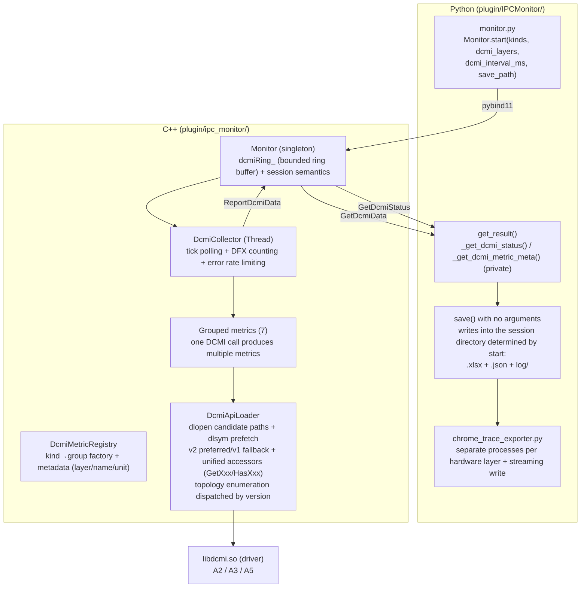
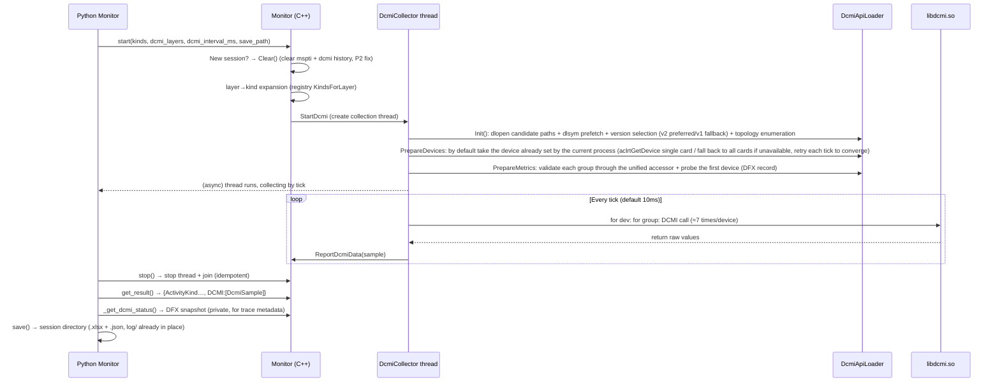
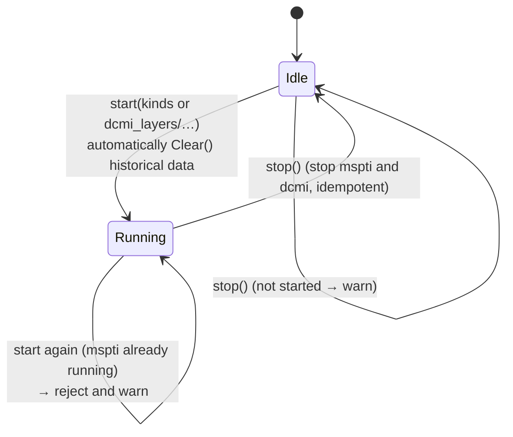
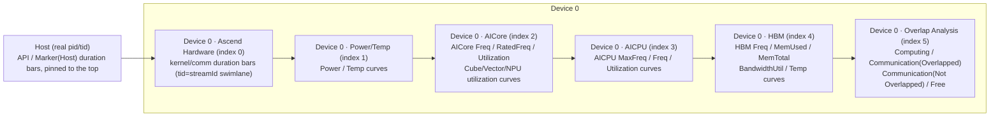
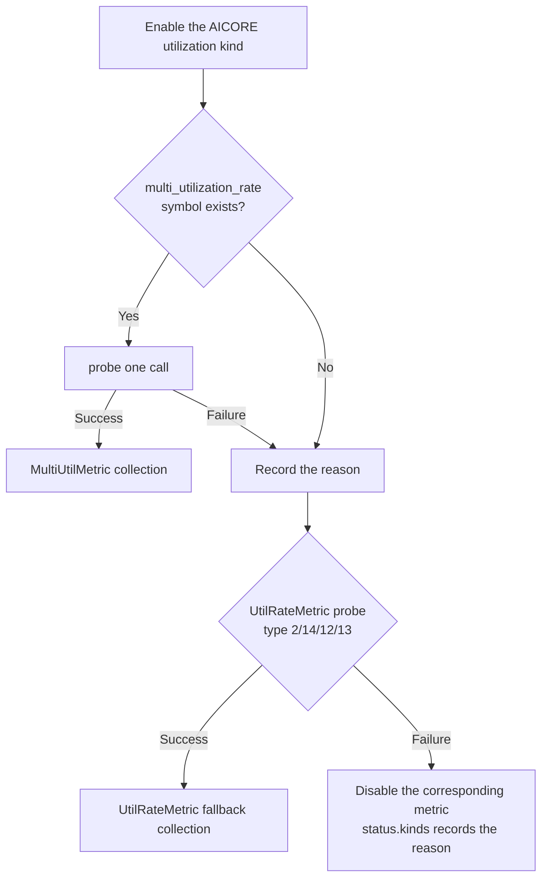
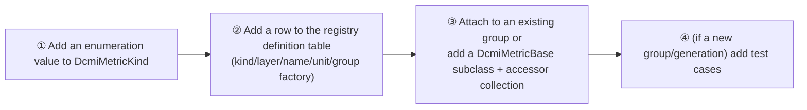

# msmonitor DCMI Collection + Chrome Trace Layered Visualization Technical Design (RFC)

**Status**: Draft

**Authors**: @kali20gakki1

**Created**: 2026-08-22

**Updated**: 2026-08-31

**Related issue/PR**: Reference implementation [Ascend/msmonitor !133 (support dcmi collect)](https://gitcode.com/Ascend/msmonitor/pull/133) (this proposal is a redesign based on the review comments of that PR)

---

# 1. Overview

## 1.1 Introduction

This proposal adds two capabilities to the Monitor API (`plugin/IPCMonitor/`) built into the `msmonitor` whl package:

1. **DCMI hardware metric collection**: A dedicated C++ thread dynamically loads `libdcmi.so` via `dlopen` to collect NPU card device-level metrics (power/temperature) and per-hardware-layer metrics (AICore frequency and utilization, AICPU max/current frequency and utilization, HBM on-chip memory frequency/capacity/usage/bandwidth utilization/temperature). The Python interface **configures collection items by hardware layer (DEVICE/AICORE/AICPU/HBM)**, uniformly configured in `Monitor.start()` together with the original `ActivityKind`.
2. **Chrome Trace JSON visualization export**: `Monitor.start(..., save_path)` determines the session directory `<save_path>/msmonitor_<pid>_<timestamp>/` (glog writes directly into its `log/` from the start), and `Monitor.save()` exports with no arguments, generating a Chrome Trace JSON and an Excel file within it (`monitor_result.json` can be opened in `chrome://tracing` / Perfetto; kernel/comm duration bars (X events) and DCMI metric curves (C counter events) are **presented as separate processes per hardware layer**, with kernels separated into swimlanes by stream), with no moving/copying and no outer temporary log directory.

Core value: Align "operator duration (software view)" and "hardware state (power/frequency/utilization, hardware view)" on the **same timeline**, helping locate whether a training/inference performance bottleneck is "the operator itself is slow" or "the hardware is downclocked/limited/bandwidth-saturated".

## 1.2 Motivation

- **Current pain points**: The current Monitor can only collect mspti operator-class data (Kernel/Communication/API/Marker) and cannot answer questions such as "while the operator is running, what is the hardware frequency, how much power is consumed, is the HBM bandwidth saturated, and is the AICPU becoming a bottleneck". Developers troubleshooting performance issues need to use separate commands such as `npu-smi` for manual sampling, which cannot be aligned with the operator timeline.
- **User scenarios**:
  - Training/inference performance analysis: Enable collection with one click in vLLM or PyTorch training scripts, and after completion see kernel swimlanes and AICore frequency/utilization curves simultaneously in Perfetto to determine whether DVFS downclocking occurs and whether HBM bandwidth is saturated.
  - Hardware health/trend observation: Collect power/temp curves over a long period to observe power ramp-up and temperature trends (stress test scenarios).
  - Fault localization: Abnormalities such as a missing `libdcmi.so`, an unsupported interface (generational differences), and error returns from calls require clear DFX means for investigation rather than silent failures.
- **Necessity**: The DCMI interface is the only unified device-level metric interface for Ascend hardware, and the official documentation covers all generations of A2/A3/central training card (A5/950). Without this proposal, the hardware view capability of Monitor will be missing for a long time.
- **Impact of not doing it**: Users continue to rely on manual `npu-smi` sampling, which cannot be aligned with the operator timeline, resulting in low problem localization efficiency.

## 1.3 Goals

**Goals**:

- G1: DCMI is collected by a dedicated C++ thread, the Python interface configures collection items by hardware layer, and the collection overhead is extremely small (full layers per device per tick ≈7 DCMI calls, ≈16 samples).
- G2: The Monitor interface uniformly configures the original `ActivityKind` and the new `DcmiLayer`.
- G3: Export supports both Excel and Chrome Trace (dcmi curves, kernel/comm duration bars), presented as separate processes per hardware layer.
- G4: The DCMI module is easy to extend (registry + grouped metric abstraction; adding a new metric requires zero changes to Collector/Exporter).
- G5: Complete DFX — so load failure, missing symbols, and interface error returns all have localization means (startup log summary + trace metadata embedded status).
- G6: Compatible with A2 / A3 / A5 (950) generation chips — **DCMI v2 preferred, automatic v1 fallback** (v1-only libraries go directly to v1, v2-only libraries go to v2), automatically adapting to the number of NPU chips per card and interface differences.

# 2. Use Case Analysis

## 2.1 Use Case List

| ID | Use Case | Description | Key Performance Indicator | DFX Requirement |
|---|---|---|---|---|
| UC1 | Joint training/inference performance analysis | Collect Kernel/Communication + full hardware layer DCMI, export Chrome Trace for viewing on the same timeline | A sampling interval ≤10ms does not affect the training main flow; the exported file can be opened normally by Perfetto | Collection exceptions do not block training; the trace is self-describing (metadata contains DFX status) |
| UC2 | Hardware trend/stress test observation | Collect only DCMI (run operators under high load), observe power/temp/freq/bandwidth curves | 10ms-level sampling; bounded ring without OOM | Overflow/timeout is visible (`ringDropCount`/`overrunCount`) |
| UC3 | Tabular analysis | Excel export: DCMI samples + DFX status Sheet, facilitating scripted/manual analysis | Million-level samples can be exported | The DCMI Sheet contains layer/unit, and the status Sheet contains loading and enabling information |
| UC4 | Fault localization | Quickly localize when `libdcmi.so` is missing / symbols are missing / the interface is unsupported / a call returns an error | Error logs are rate-limited without flooding | The startup log summarizes loading status, missing symbols, enabling reasons, and failure counts; written into trace metadata |
| UC5 | Multi-generation deployment | The same whl runs on A2 / A3 / A5 | Automatic adaptation, no manual configuration | Unsupported types are automatically disabled with a reason given |

## 2.2 Usage Restrictions and Constraints

| Constraint | Description |
|---|---|
| Runtime environment | Linux only (depends on `dlopen`/`pthread`), the NPU driver is installed and `libdcmi.so` can be loaded (by default searches LD_LIBRARY_PATH and fixed candidate paths) |
| Permissions | Both root and non-root on bare metal are allowed (official support matrix); container scenarios require root and some interfaces are unsupported (for example, the bandwidth utilization in an AVI container is 0) |
| Generational differences | A2/A3 support utilization type 2,3,4,6,10,12,13,14; A5 (training card) supports 1,2,3,4,5,6,10 — unsupported metrics are automatically disabled with a prompt |
| Sampling and storage | Default 10ms interval, the sample ring buffer is fixed at 1 million entries (internal policy, overwrites the oldest when full); long-duration high-rate sampling may cause ring overwrite or a larger trace file, so the interval needs to be increased per scenario |
| Data security | Only device-level public metrics are collected (power/frequency/temperature/utilization/memory); user data, operator inputs, weights, and the like are not collected |

# 3. Solution Design

## 3.1 Overall Solution

### 3.1.1 Overall Architecture



### 3.1.2 Data Link (Sequence)



### 3.1.3 Session Semantics (State Machine)



### 3.1.4 Chrome Trace Layered Presentation

Each device is presented as 6 processes in the trace (`pid = 1_000_000 + device number×6 + index`, `process_sort_index`: Host=0 pinned to the top, devices by 1000+index; Host uses the real pid):



## 3.2 Technology Selection

| Option | Alternative | Choice | Comparison Conclusion |
|---|---|---|---|
| DCMI integration method | A: Link DCMI headers/libraries at compile time | **B: `dlopen`/`dlsym` dynamic loading** | A depends on the driver development package and is strongly bound to the driver version; B has no compile-time dependency, can degrade when symbols are missing, and has zero parsing overhead during collection (dlsym is prefetched once), aligning with the CANN `prof_timer` pattern |
| Python configuration model | A: Flat `DcmiMetricKind` enumeration (17 items) selected one by one | **B: Configure by hardware layer `DcmiLayer`** | A has many items and is disconnected from the underlying fact that "one interface returns multiple metrics of the same layer"; B layer=interface corresponds naturally (HBM layer↔`hbm_info`), selecting a layer collects all, with less configuration and predictable overhead |
| Collection call model | A: One DCMI call per metric (3 items=3 calls) | **B: Grouped metrics, one interface call produces multiple kinds** | A has a call count that grows linearly with metrics; B has ≤2 calls per layer (the struct API returns in batch), and only ≈7 for all layers |
| Utilization collection | A: Only `dcmi_get_device_utilization_rate` per type | **B: Prefer `multi_utilization_rate` (1 call returns 4 items); degrade to A when missing/failing** | B is more economical in calls; the degradation path is automatically decided by probe, adapting to generational differences |
| Sample storage | A: Unbounded vector | **B: Bounded ring buffer (default 1M, overwrites the oldest when full)** | A causes OOM on long runs; B has bounded memory and countable overflow (DFX) |
| Export implementation location | A: Generated in C++ | **B: Python (`chrome_trace_exporter.py`)** | The data is already bound to Python via pybind, and Excel export is already in Python; B keeps C++ lightweight, reuses the existing file management, and controls memory with streaming write |
| Thread model | A: One thread per device | **B: A single thread polling all devices×metrics** | Aligns with `prof_timer`; 7 calls/device/tick has ample overhead at the default 10ms tick, automatically downclocks on timeout, and avoids thread explosion |
| Enumeration extension | A: Extend the third-party `msptiActivityKind` | **B: Independent `DcmiLayer`/`DcmiMetricKind`** | The mspti enumeration cannot be changed; independent enumerations + registry metadata implement a single source of truth |
| Version policy | A: v1 only (the PR !133 approach) | **B: v2 preferred + automatic v1 fallback** | 950 is v2-only (v1 init -8255); 910B has no dcmiv2 symbols and automatically goes to v1; new drivers such as A3 have a dual stack and automatically use v2 — v2 preferred is correct and forward-looking for all three generations |
| Generational dispatch location | A: `if (v2) ... else ...` inside each metric | **B: Unified accessors in `DcmiApiLoader` (`GetXxx`/`HasXxx`)** | Dispatch converges to one place in the loader, with zero generational branches in the metric layer; adding a DCMI version/interface only changes the loader |

## 3.3 Function and Performance Design

### 3.3.1 Function Points

| Function | Description |
|---|---|
| Layer configuration expansion | `Monitor.start(dcmi_layers=...)` → the C++ registry `KindsForLayer(layer)` expands into a set of kinds |
| Collection | Dedicated thread tick collection; the devices parameter is not exposed, and by default the device already set by the current process is taken (`aclrtGetDevice`), falling back to all visible cards if unavailable and retrying each tick to converge to a single card |
| Version adaptation | `DcmiApiLoader` prefers v2 (`dcmiv2_init` + `dcmiv2_get_device_list`), and automatically falls back to v1 when symbols are missing/init fails/enumeration fails; failures are reported with merged reasons (DFX) |
| Degradation | Multiple interfaces/types are probed item by item through the unified accessor; unsupported metrics are automatically disabled with the reason recorded; when `multi_utilization` is missing, UtilRate falls back per type |
| Export | `.xlsx` (DCMI Sheet), `.json` (Chrome Trace layered + Overlap Analysis) |
| DFX | The status snapshot (including version/duration of each interface) is provided for trace metadata via the private `_get_dcmi_status()`; error logs are rate-limited; a stop summary log is emitted; non-collectable metrics are prompted at startup |

### 3.3.2 Data Model

**DcmiSample** (one sample per row):

| Field | Type | Description |
|---|---|---|
| kind | DcmiMetricKind | Metric type |
| timestampNs | uint64 | Sampling timestamp (ns) |
| deviceId | int32 | Flat device number |
| value | double | Sampled value (unit is in the registry metadata) |

**DcmiMetricMeta** (maintained by the registry, the single source of truth for Python export/DFX):

| Field | Description |
|---|---|
| kind / layer | Metric type / hardware layer it belongs to |
| name / displayName | Enum name / display name (such as `AICore Freq`) |
| unit | Unit (`W`/`MHz`/`%`/`MB`/`℃`) |

**DcmiStatusSnapshot** (returned by the private `_get_dcmi_status()`, DFX):

| Field | Description |
|---|---|
| load | Loading status (statusName, matched path, missing symbols, dcmi_init return code, card count/chips per card, collection device list, error reason) |
| kinds | Enabling status and non-enabling reason for each metric |
| tickCount / overrunCount | Tick count / timeout count (automatic downclocking on timeout) |
| ringDropCount / ringSize / ringCapacity | Ring full-overwrite count / current sample count / capacity |
| groupFailCounts / lastErrorCodes | Call failure count for each interface / most recent error codes |

### 3.3.3 Performance Design

**Call overhead per device per tick** (16 metrics across all layers):

| Group | DCMI Call | Number of Produced kinds | Unit |
|---|---|---|---|
| PowerMetric | `power_info` | 1 | W (×0.1) |
| TempMetric | `temperature` | 1 | ℃ |
| AicoreInfoMetric | `aicore_info` | 2 | MHz |
| MultiUtilMetric | `multi_utilization_rate` | 4 | % |
| AicpuInfoMetric | `aicpu_info` | 2 | MHz |
| UtilRateMetric | `utilization_rate`(type=3) | 1 | % |
| HbmInfoMetric | `hbm_info` | 5 | MB/MHz/%/℃ |
| **Total** | **≈7 calls** | **≈16 samples** | |

**Overhead budget** (a DCMI ioctl is typically ≤50μs per call, referring to the measured `prof_timer`; **on real hardware utilization_rate can reach ~36ms per call**):

| Scenario | Calls/Tick | Estimated Duration | Conclusion |
|---|---|---|---|
| Single device × all layers | 7 | ≤350μs (when the util interface is slow, it is kept within budget by throttling) | A 1ms tick is feasible |
| 8 devices × all layers | 56 | ≥2.8ms (can reach 1.5s when util is slow) | Automatic downclocking on timeout + **automatic convergence to a single card** + **slow-interface throttling** |
| Single device × single layer (such as HBM only) | 1~2 | ≤100μs | A 1ms tick is ample |

**Real-hardware measurements and countermeasures (2026-08-22 ~ 08-24, 910B and 950 servers)**:

- 910B (v1-only): A single call to `dcmi_get_device_utilization_rate` takes ≈36ms (driver behavior), and the `libdcmi.so` on that machine lacks the `dcmi_get_device_multi_utilization_rate` symbol → utilization requires 5 per-type calls → 8 devices × 5 = 40 calls ≈ 1.46s per tick, accounting for 92% of the tick.
- 950 (v2-only): The entire v1 chain returns -8255; after v2 takes effect, struct interfaces such as `multi_utilization_rate`/`hbm_info` return multiple values in one call, **all 16 metrics are available**, and there is no per-type utilization problem like on 910B; `utilization_rate` (AICPUUtil) is likewise slower (~36ms per call), and throttling continues to take effect.
- Countermeasure 1 (**slow-interface throttling**): `DcmiMetricBase::SampleEveryTicks()` downclocks by group; UtilRateMetric collects once every 10 ticks by default, and the per-tick budget falls back to the millisecond level.
- Countermeasure 2 (**automatic convergence to a single card**): The devices parameter is not exposed; if `aclrtGetDevice` cannot obtain the current device at startup (start occurs before torch set_device), it first falls back to all cards, and the collection thread **retries each tick**, converging to a single card once the current device is obtained.
- Countermeasure 3 (**final sample**): At stop, one final sampling tick is added (skipping the slow-interface throttling gate), ensuring the curve covers up to the stop moment and overlaps with the tail of the kernel window.
- Countermeasure 4 (DFX closed loop): After stop, the collector state is retained and remains readable via the private `_get_dcmi_status()` and written into trace metadata; `version/groupCallCounts/groupCollectNs/lastTickCollectUs` allow per-interface verification of whether the duration and downclocking take effect.
- Countermeasure 5 (**the timestamp of the final sampling tick takes the collection completion moment**): Ordinary tick samples use the tick start as the timestamp (so the start points of the metrics in the same tick are aligned); only the final tick timestamps after collection completes, avoiding a slow interface (utilization_rate can reach the hundred-ms level) making the last sample earlier than the real stop moment and leaving a void at the tail of the timeline (two rounds of fixes measured on 2026-08-31: first timestamping per group caused misaligned start points of the metrics, then it converged to timestamping at the end of the tick for the final tick only); the accompanying example synchronizes all compute streams before stop, so the tail of the DCMI curve overlaps with the kernel window.

**Memory budget**:

| Item | Budget |
|---|---|
| Default ring capacity 1 million × DcmiSample (≈32B) | ≈32MB (overwrites the oldest, bounded) |
| Exported JSON (1M samples × ≈90B) | ≈90MB worst case (streaming write, no full-tree residency) |

**Downclocking mechanism**: If the tick start has already timed out, `nextNs = now + interval` (no catch-up) and `overrunCount++`, ensuring the collection thread does not accumulate burst backfill sampling.

### 3.3.4 Boundary Scenario Design

| Boundary Scenario | Behavior | Verification Point |
|---|---|---|
| `libdcmi.so` missing/not loadable | `Init()` returns NOT_SUPPORT, one `LOG(WARNING)`, DCMI is disabled as a whole, and operator-class collection is unaffected | status.load.statusName=NOT_SUPPORT + error readable |
| v1-only library (910B, no dcmiv2 symbols) | The v2 branch skips when the dlsym pointer is null and goes directly to v1 | version=V1, normal collection |
| v2-only library (950, v1 init -8255) | The v1 attempt fails → automatically v2 (`dcmiv2_init` + `dcmiv2_get_device_list`) | version=V2, all 16 items collected |
| v2 init succeeds but v2 enumeration fails | Fall back to v1; report merged reasons when both fail | status.error contains `v2(reason); v1(reason)` |
| Critical symbols missing (no init/enumeration) | NOT_SUPPORT, `missingSymbols` lists the missing symbols | Localizable from both the log and status |
| Non-critical symbols missing (such as `dcmi_get_dcmi_version`) | Recorded only, not blocking | Normal collection |
| Single-card/multi-card device enumeration failure | Skip the failed cards and the rest work normally; FAILED if all fail | Enumeration result is included in status |
| Current device not set (start occurs before torch set_device) | Fall back to all cards + retry `aclrtGetDevice` each tick, converging to a single card once obtained | No crash; only the current card is collected after convergence |
| Interface type unsupported on the target device (generational difference) | probe fails → that metric is disabled + the reason is recorded, the rest work normally | The reason is clear in status.kinds |
| `multi_utilization` missing → AICORE utilization fallback | Automatically create UtilRateMetric to take over with type 2/14/12/13 | status.kinds shows the enabling source |
| Collection tick timeout | Automatic downclocking + overrunCount++, no catch-up | No accumulation on long runs, count is visible |
| Final sample | At stop, one tick is added (skipping slow-interface throttling), the curve covers up to the stop moment | The curve tail overlaps with the kernel window |
| ring full | Overwrite the oldest + `ringDropCount++` (DFX); ring capacity is fixed at 1M (internal policy) | Bounded memory on long runs |
| `start()` with no kinds/layers/metrics | `[ERROR]` prompt and return, no start | No crash |
| Illegal parameters (wrong type/non-positive) | Python-side validation returns `[ERROR]`; the C++ side filters by the valid set | Boundary input does not penetrate to C++ |
| Session residual data (mspti first, then DCMI only) | A new session always calls `Clear()` to avoid mixed data (P2) | get_result does not contain old samples |
| start again while mspti is already running | Reject and warn (retaining the status quo) | No duplicate start |
| stop() when not started/repeatedly called | Idempotent; when not started it only warns | No crash, no hang |
| Collection thread Stop delay | Segmented sleep ≤1ms, join returns promptly | No long blocking |
| Large-sample export (1M+) | Streaming JSON write; Excel row-by-row write | Memory does not grow linearly with samples |
| Container/AVI scenario | Unsupported interfaces fail probe and are automatically disabled; bandwidth and the like are output normally when 0 | No exception, status is queryable |

### 3.3.5 Test Case Design

#### 3.3.5.1 Unit Tests (C++ gtest, `python build.py test local`)

| Case | Coverage Point | Assertion Point |
|---|---|---|
| test_DcmiRingBuffer | Ring buffer Push/Snapshot/Clear/overwrite/capacity 0 | Order, full-overwrite returns true, empty after Clear, capacity 0 is safe |
| test_DcmiMetricRegistry | Layer→kind expansion, group deduplication, unknown kind ignored, complete metadata, UtilRate fallback creation | DEVICE layer=2 items, AICORE layer=AicoreInfo+MultiUtil two groups, meta≥16 items |
| test_DcmiCollector | Fake loader injection (`InjectForTest`) + fake metric: tick sampling, failure counting and rate limiting, invalid device rejection, Stop idempotency, rejection when no metric is enabled | tickCount≥1, samples≥1, failCount≥1 and lastErrorCode=42, no samples |
| test_DcmiMonitorSession | ring clearing, DCMI-only session start clears old data (P2 regression), rejection with no input, status snapshot, fixed ring capacity | Old samples are cleared, ringCapacity=1M, no crash |

#### 3.3.5.2 Python Unit Tests (`python -m unittest discover -s test/ut/python`)

| Case | Coverage Point | Assertion Point |
|---|---|---|
| test_chrome_trace_exporter | schema, kernel layered pid/tid, DCMI curves enter the correct layer, time base normalization, process/thread naming, Host pinned-to-top sorting, Overlap Analysis computing/communication/Free intervals, metadata embedded status | `pid=1M+dev×6+index`, counter name contains the unit, minimum timestamp normalized to zero, Host sort_index=0 |
| test_monitor_dispatch | start validation and parameter passthrough (kinds/layers/interval/save_path), get_result merging DCMI, save() with no arguments writing into the session directory, `get_dcmi_status` converged to private | Illegal input does not call C++, parameter order/default values (interval=10, save_path=None online only) are correct |

#### 3.3.5.3 Integration and Real-Hardware Acceptance Cases (executed once each on A2 / A3 / A5)

| Case | Step | Expected |
|---|---|---|
| End-to-end (st) | `python test/st/test_dcmi_fa_comm_multistream.py` | Each rank produces a session directory (xlsx/json/log), and the DCMI counters and kernel events in the json are non-empty (automatic assertion); opening in Perfetto shows 6 layer processes (Host pinned to the top + 6 layers per device), kernel swimlanes, curves aligned with the operator timeline, and the Overlap Analysis row |
| Generational switching | Run the st end-to-end case on v1-only (910B), v2-only (950), and dual-stack (A3, to be verified) models respectively | version is automatically V1/V2/V2, and all 16 metrics can be collected |
| Fault drill 1 | Temporarily rename `libdcmi.so` | No crash, DCMI disabled, operator collection normal, trace metadata has the reason |
| Fault drill 2 | Construct an unsupported type (such as forcing probe failure) | The corresponding metric is disabled and the rest work normally |
| Long-run stability | Run for 10 minutes at a 100ms interval | No memory growth (bounded ring), no log flooding |

### 3.3.6 Impact Scope

- Modified: `monitor/Monitor.{h,cpp}`, `plugin/bindings.cpp`, `plugin/CMakeLists.txt`, `plugin/IPCMonitor/{monitor.py,__init__.py}`, `test/ut/plugin/ipc_monitor/CMakeLists.txt`.
- Added: `plugin/ipc_monitor/dcmi/*` (9 files), `plugin/IPCMonitor/chrome_trace_exporter.py`, `test/ut/python/*`, `test/st/test_dcmi_fa_comm_multistream.py` (end-to-end), this document.
- Backward compatibility: The old `start(kinds)` calling style is unchanged (new parameters have default values, `devices` has been removed and `save_path` is added); `save()` no longer accepts a path (the output directory is determined by `start(save_path)`); `get_result()` has the same key set as the old version when DCMI is absent (the new `DCMI` key appears only when DCMI is enabled).

## 3.4 Security, Privacy, and DFX Design

### 3.4.1 Compatibility (A2 / A3 / A5)

**Interface surface and units confirmed by official documentation** (26.1.x DCMI API reference: three copies for A2/A3/central training card):

| API | Signature Point | Unit | Generational Difference |
|---|---|---|---|
| `dcmi_get_device_power_info` | `(card, dev, int *power)` | **0.1W** | Consistent across three generations |
| `dcmi_get_device_temperature` | `(card, dev, int *temp)` | ℃ | Consistent across three generations |
| `dcmi_get_device_aicore_info` | `struct {freq, cur_freq}` | MHz | Consistent across three generations |
| `dcmi_get_device_aicpu_info` | `struct {max_freq, cur_freq, aicpu_num, util_rate[]}` | MHz | Consistent across three generations |
| `dcmi_get_device_hbm_info` | `struct {memory_size, freq, memory_usage, temp, bandwidth_util_rate}` | MB/MHz/%/℃ | Consistent across three generations |
| `dcmi_get_device_multi_utilization_rate` | `struct {aic_util, aiv_util, aicore_util, npu_util}` | % | Consistent across three generations |
| `dcmi_get_device_utilization_rate` | `(card, dev, type, unsigned int*)` | % | A2/A3 support 2,3,4,6,10,12,13,14; A5 supports 1,2,3,4,5,6,10 |
| `dcmi_get_device_id_in_card` | `(card, &device_id_max, &mcu_id, &cpu_id)` | - | **A2/A5 have 1 NPU per card, A3 has 2 NPUs per card** |

**Adaptation mechanism** (the code does not hardcode generation names):

1. **Version selection**: v2 is preferred (`dcmiv2_init` + `dcmiv2_get_device_list`), automatically falling back to v1 when symbols are missing/init fails/enumeration fails (`dcmi_init` + `dcmi_get_card_list` + `dcmi_get_device_id_in_card`); `LoadInfo.version` indicates the effective version.
2. **Unified accessors**: `DcmiApiLoader::GetXxx/HasXxx` dispatch by version (v1 uses (card,dev), v2 uses a flat dev_id), with zero generational branches in the metric layer.
3. Per-metric probe: Validation through accessors at the Init stage + a first-device call; an unsupported type → automatically disabled with the reason recorded.
4. Dual utilization paths: When `multi_utilization_rate` is missing/failing → `utilization_rate` falls back by type.

**DCMI v2 (measured on 950, signatures from the 950 `dcmi_interface_api.h`)**:

v2 is a **flat dev_id model** (single parameter), with a struct layout consistent with v1:

| API | Signature | Description |
|---|---|---|
| `dcmiv2_init` | `int(void)` | v2 initialization |
| `dcmiv2_get_device_list` | `int(int *device_list, int *device_cnt, int list_len)` | Flat device enumeration (8 on 950) |
| `dcmiv2_get_device_power_info` / `temperature` | `int(int dev_id, int *out)` | Single parameter |
| `dcmiv2_get_device_frequency` | `int(int dev_id, enum dcmi_freq_type, unsigned int *)` | type 2/6/7/9 |
| `dcmiv2_get_device_utilization_rate` | `int(int dev_id, int type, unsigned int *)` | type 2/3/12/13/14 |
| `dcmiv2_get_device_aicore_info` / `aicpu_info` / `hbm_info` / `multi_utilization_rate` | `int(int dev_id, struct *)` | Struct consistent with v1 |

**Limitations found by real-hardware measurement on 910B (Atlas central training card)** (2026-08-22 server, npu-smi confirms Chip=910B3):

| utilization type | Name | Documented Support (910B training card) | Measured |
|---|---|---|---|
| 2 | AI Core | ✅ | 0 (querying returns 0 when profiling is enabled, as noted in the documentation) |
| 3 | AI CPU | ✅ | 0 (same scenario as the preceding row) |
| 12 | Vector Core | ❌ Unsupported | 0 (garbage value) |
| 13 | NPU overall | ❌ Unsupported | 100 (garbage value) |
| 14 | AI Cube | ❌ Unsupported | 0 (garbage value) |

That is: **the driver returns success but a value of 0/100 for unsupported types**, and probe cannot distinguish "unsupported" from "genuinely idle" based on the return code alone.
→ DFX means (**a one-time prompt at execution time, with zero runtime overhead**):

- At startup, the C++ side emits a summary `LOG(WARNING)` listing the metrics that could not be enabled on the current device and the reasons (missing symbols/probe failure, etc.), written into the glog log;
- The internal `_get_dcmi_status()` status snapshot is written into trace metadata for later verification;
- No runtime value detection or post-hoc quality analysis is performed (to avoid collection overhead); when displaying, judge in combination with the official support matrix
  (AI Cube/Vector/NPU Utilization on 910B should be regarded as meaningless and ignored).



### 3.4.2 Maintainability (Extension Points)

- **Adding a metric**: ① Add an enumeration value to `DcmiMetricKind`; ② Add a row to the definition table in the registry `RegisterDefaults()` (kind/layer/name/unit/group factory); ③ (for a new group) implement a `DcmiMetricBase` subclass and collect through the accessor. Collector / Monitor / Python exporter require zero changes.
- **Adding a generation/version**: Only change the accessor dispatch (`GetXxx`/`HasXxx`) and the symbol table in `DcmiApiLoader`; the metric/Collector/export layers require zero changes.



### 3.4.3 Testability

- C++ side: `DcmiApiLoader::InjectForTest()` skips dlopen/dlsym and directly injects the symbol table and topology; the registry `Register()` is public, and UT can override the default factory with a fake metric — the collection thread can be tested for tick/counting/rate limiting in an environment without hardware.
- Python side: `test_monitor_dispatch` is driven by a fake `_ipcmonitor_C` module; `test_chrome_trace_exporter` is driven by fake data rows; neither depends on real hardware.
- Real-hardware acceptance cases are in §3.3.5.3.

### 3.4.4 Reliability

| Risk Area | Measure |
|---|---|
| High-frequency error logs flooding | Error log rate limiting: first occurrence + every 1000 occurrences of the same error (the count goes into status) |
| Accumulated tick timeouts | No catch-up backfill sampling, `nextNs = now + interval`, overrun counting |
| Memory growth | Bounded ring (default 1M) + overwrite counting; streaming export write |
| Thread leak/hang | Idempotent Stop + join; segmented sleep ≤1ms; destructor as a fallback to stop the thread |
| Single-point interface failure spreading | Failures are counted independently per group, and a failure does not affect other groups or mspti |

### 3.4.5 Security and Privacy

- Data content: Only device-level public metrics (power/frequency/temperature/utilization/memory usage), not involving user models, weights, operator inputs, or communication data content.
- Loading security: `dlopen` uses fixed candidate paths (LD_LIBRARY_PATH + fixed system paths) and does not perform arbitrary path injection; symbols are `dlsym`-loaded only from an allowlist.
- No new third-party dependencies (Chrome Trace export uses the standard library `json`).
- File write permissions reuse the secure creation logic of the existing `FileManager` (rejecting symlinks, permission checks).

## 3.5 Programming and Calling Design

### 3.5.1 Basic Programming Model Design

**Development environment design**: The developer = a model script developer using the whl (Python), with no need to touch C++; secondary development (adding a DCMI metric) requires a Linux + C++17 + pybind11/glog build environment.

**Development constraints**: Linux only; DCMI depends on the driver providing `libdcmi.so`; in `torch_npu` scenarios the current device can be located automatically; Windows is not supported.

**Acceptance design**:

- Functional acceptance: The cases in §3.3.5 pass.
- Performance acceptance: Collect at a 1ms interval for 60s on a single device, with collection thread CPU usage < 5% (single core) and training step degradation < 1% (against a baseline without collection); the ring overflow/timeout count is 0 or explainable.
- DFX acceptance: Fault drills 1/2 pass, and the reasons in the startup log and trace metadata are readable.

### 3.5.2 Interface Definition and Design

#### 3.5.2.1 Monitor.start

- Interface description: Uniformly enable mspti operator-class and DCMI hardware metric collection (a new session automatically clears historical data; DCMI devices by default take the device already set by the current process, with no devices parameter).
- Interface prototype:

  ```python
  @classmethod
  def start(cls, kinds=None, dcmi_layers=None,
            dcmi_interval_ms=10, save_path=None)
  ```

- Input parameters:

  | Parameter Name | Input/Output | Type | Description | Value Range |
  |---|---|---|---|---|
  | kinds | Input | List[ActivityKind] | mspti operator-class collection types | Empty/valid enumerations |
  | dcmi_layers | Input | List[DcmiLayer] | Hardware layer configuration (selecting a layer collects all metrics of that layer); empty means DCMI is not collected | DEVICE/AICORE/AICPU/HBM |
  | dcmi_interval_ms | Input | int | DCMI sampling interval | ≥1 (default 10) |
  | save_path | Input | str | Result save directory (default None=online get_result() only, no directory creation/no log to disk); when specified, start creates the `msmonitor_<pid>_<timestamp>/` session directory under it immediately, and glog writes directly into its `log/` from the start | A writable directory or None |

- Return parameter: None.
- Exception handling: Illegal parameters → `[ERROR]` printed and return, no exception thrown; `libdcmi.so` unavailable → DCMI is silently disabled (log + status queryable), without affecting operator classes.
- Constraint description: Starting again while mspti is already running is rejected; a new session automatically Clears.
- Change description: Parameters are backward compatible (the old call `start(kinds=[...])` is unchanged); fine-tuning within the `dcmi_metrics` layer is no longer exposed (metric-level configuration converges to layer-based, and an empty list is always passed internally); the `devices` parameter is removed (the device already set by the current process is collected by default); `save_path` is added (the session directory is created directly under it, save does not need to pass a path again, and there is no moving/copying).
- Calling reference code:

  ```python
  monitor = Monitor()
  monitor.start(
      kinds=[ActivityKind.Kernel, ActivityKind.Marker],
      dcmi_layers=[DcmiLayer.AICORE, DcmiLayer.HBM],   # Configure by hardware layer
      dcmi_interval_ms=10,
      save_path="./out",
  )
  ```

#### 3.5.2.2 Monitor.save

- Interface description: Export data to the session directory determined by start (whatever data exists is what is generated).
- Interface prototype: `save()`
- Input parameters: None (the output directory was already determined at `start(save_path)`).
- Description: Generates `monitor_result.xlsx` and `monitor_result.json` within `<save_path>/msmonitor_<pid>_<timestamp>/`; glog writes directly into its `log/` from start, with no moving/copying and no outer temporary log directory.
- Return parameter: None.
- Exception handling: Write failure → `[ERROR]` printed; a warning is issued before overwriting an existing file.

#### 3.5.2.3 Monitor.get_result (_get_dcmi_status / _get_dcmi_metric_meta are private)

- `get_result() -> dict`: The keys are the enabled `ActivityKind` and `DCMI` (a sentinel object whose value is `List[DcmiSample]`).
- `_get_dcmi_status() -> dict` (**private**): DFX snapshot — `load` (including `version`: V1/V2), `kinds` (enabling/reason), `tickCount/overrunCount/lastTickCollectUs`, `groupCallCounts/groupCollectNs` (call count/duration for each interface), `groupFailCounts/lastErrorCodes`, `ringDropCount/ringSize`. Used for trace metadata and not exposed publicly (DFX information is based on the startup log + written files).
- `_get_dcmi_metric_meta() -> list` (**private**): Metric metadata (kind/layer/name/displayName/unit), used for Excel/Chrome Trace export, not exposed publicly.

#### 3.5.2.4 Enumerations and Data Structures

- `DcmiLayer`: DEVICE / AICORE / AICPU / HBM.
- `DcmiMetricKind`: Internal enumeration (Power, Temp, AICoreFreq, …, HBMTemp, with Voltage reserved), referenced by `DcmiSample.kind`, **not exported publicly** (collection configuration is controlled only by `dcmi_layers`).
- `DcmiSample`: `kind / timestampNs / deviceId / value` (including `to_tuple()`).

### 3.5.3 Programming Manual Design

Updated within existing manuals (not as a separate document):

| Document | Change |
|---|---|
| `docs/en/advanced_features/monitor_feature.md` | DCMI function description, layer-based configuration example, `.json` export example, DCMI Sheet fields, Chrome Trace layered description |
| `docs/en/advanced_features/mindstudio_monitor_api_reference.md` | New `start` parameters (default 10ms, save_path), `DcmiLayer` enumeration, `DcmiSample` structure, `save()` no-argument semantics (`get_dcmi_status`/`get_dcmi_unavailable` have converged) |
| `docs/en/design/dcmi_chrome_trace_plan.md` | This document (RFC) |

# 4. Drawbacks and Risks

| Risk/Drawback | Impact | Response |
|---|---|---|
| Breaking Change: `start_monitor` binding signature change | Compile-time binding parameters increase (with default values), and old Python-layer calls are unchanged | Default values ensure backward compatibility; a review focus (the same signature extension as PR !133) |
| Performance regression: DCMI calls occupy the collection thread | Multi-device 1ms intervals may time out | Automatic downclocking without catch-up + overrun counting; the documentation recommends increasing the interval for multiple devices |
| Increased complexity: v1/v2 dual versions + utilization fallback | Dispatch is centralized but there are many branches | Dispatch converges to the unified accessor in the loader (zero branches in the metric layer); the fallback is only one group, UtilRateMetric; UT coverage |
| Compatibility risk: v2 struct layout deviates from the real header file | `aicpu_info.util_rate[64]` is a conservative declaration | The v1/v2 structs have been verified against the 950 `dcmi_interface_api.h`; probe verification; only header fields are read |
| Version switching risk: the actual behavior of v2 on dual-stack A3 models | A3 automatically goes to v2, which has not been verified on real hardware | v2 automatically falls back to v1 on failure; to be confirmed by the A3 real-hardware end-to-end case (§6) |
| Unit/semantics risk: HBM memory_usage unit, AICPU util_rate semantics | Exported values may deviate | Implement according to the official documentation and annotate the assumptions; the st end-to-end case output (first/last values) is for manual verification; deviations only require changing the metadata/conversion |
| Data volume risk: long runs + high sampling → large trace file/ring overwrite | Loss of early samples | The ring is fixed at 1M + drop counting (DFX queryable); the documentation suggests reducing the interval per scenario |
| Implementation cost | ≈9 new C++ files + exporter + tests/documentation | Already split by minimal responsibility; no new third-party dependencies |
| Legacy version migration | No data format migration (the new export format coexists with the original) | Not applicable |

# 5. Existing Technology

| Reference | Borrowed | Difference/Improvement |
|---|---|---|
| [Ascend/msmonitor !133 (demo PR)](https://gitcode.com/Ascend/msmonitor/pull/133) | dlopen/dlsym pattern, ring buffer, `aclrtGetDevice` to get the current device, base timestamp normalization | Fixes its review P2 (session residual data); P3 (header file anonymous namespace/dead code); layer-based configuration replacing flat enumeration; grouped batch calls reducing overhead; complete DFX status; `dcmi_get_device_id_in_card` enumeration by card (covering A3 dual chips) |
| CANN runtime `prof_timer.cpp` | Single-thread polling handlerMap, `GetDcmiCardDevId` mapping | Uses the official `dcmi_get_device_id_in_card` instead of the simplified `device_num` assumption |
| DSMI (`collect_lpdavid.py`) | Multi-thread + queue writer approach | A single thread already meets the overhead target, avoiding thread explosion |
| PyTorch Profiler / MindSpore Profiler | The presentation approach of timeline + hardware counters (such as CUDA clocks/DRAM bandwidth) | On the Ascend side, DCMI is the data source, presented as separate processes per hardware layer |

# 6. Open Issues

| Open Issue | Impact | To Be Decided |
|---|---|---|
| HBM `memory_usage` unit and AICPU `util_rate[]` aggregation semantics | Exported value display | 910B/950 have been collected on real hardware (the magnitude is as expected), but the formal finalization still requires manual verification of the first/last values |
| **A3 (910C) dual-stack model v2 path verification** | A3 automatically goes to v2 after v2 is preferred | Requires running `test/st/test_dcmi_fa_comm_multistream.py` on real A3 hardware to confirm version=V2 and all 16 metrics working normally |

---

# Appendix

## References

- Atlas A2 Central Inference and Training Hardware 26.1.x DCMI API Reference 02 (PDF)
- Atlas A3 Central Inference and Training Hardware 26.1.x DCMI API Reference 02 (PDF)
- Atlas Central Training Card 26.1.x DCMI API Reference 02 (PDF)
- 950 (Ascend950DT) `/usr/local/dcmi/dcmi_interface_api.h` (source of the v2 signatures, verified by real-hardware measurement)
- [Ascend/msmonitor !133 support dcmi collect](https://gitcode.com/Ascend/msmonitor/pull/133)

## Glossary

| Term | Description |
|---|---|
| DCMI | Device Control Management Interface, the Ascend device management interface |
| DCMI v1 / v2 | v1=(card_id, device_id) dual-parameter model; v2=flat dev_id single-parameter model (950 and other new generations) |
| mspti | MindStudio Performance Tracing Interface, an operator-level performance collection interface |
| Chrome Trace / Perfetto | Trace visualization frontends (`chrome://tracing` / `ui.perfetto.dev`) |
| X event / C event | Chrome Trace complete event (duration bar) / counter event (curve) |
| AICore / AICPU / HBM | AI compute core / AI control CPU / high-bandwidth on-chip memory |
| overrun | Collection tick timeout (automatic downclocking) |
| SampleEveryTicks | Slow-interface sampling throttling (once every N ticks) |

## Documentation Update Plan

- Updated: `monitor_feature.md`, `mindstudio_monitor_api_reference.md` (the list in §3.5.3).
- Real-hardware verification status: 910B (v1-only) and 950 (v2-only) have completed full collection verification; **verification of the v2 path on dual-stack A3 (910C) models is pending**.
- API convergence (2026-08-31): The `dcmi_interval_ms` default is finalized as **10ms**; the public interfaces `get_dcmi_status`/`get_dcmi_unavailable` are removed (DFX goes through logs + written files + the private `_get_dcmi_status`); fine-tuning within the `dcmi_metrics` layer is no longer exposed; the `devices` parameter is removed (the device already set by the current process is collected by default); `save` converges to no-argument — `start(save_path)` directly creates the session directory `msmonitor_<pid>_<timestamp>/` under it (glog writes into its `log/` from the start), and save only supplements xlsx + json, with no moving/copying and no outer temporary log directory.
