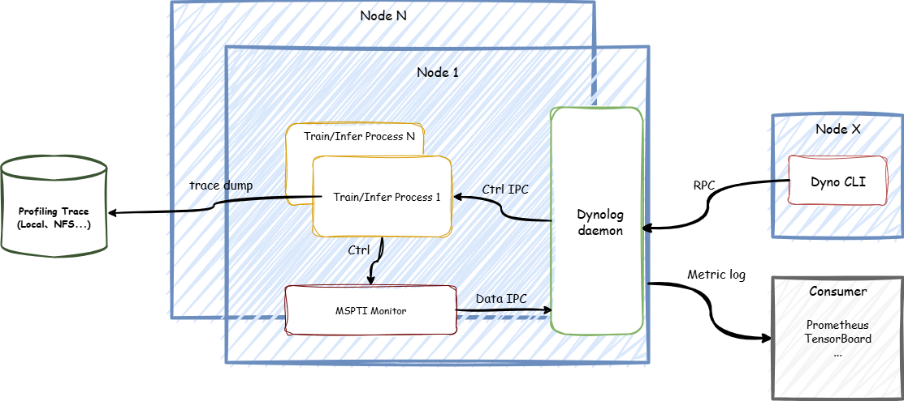

# Overview

## ℹ️ Introduction

MindStudio Monitor (msMonitor) is an online performance monitoring and dynamic collection tool for Ascend cluster scenarios. It is built on [dynolog](https://github.com/facebookincubator/dynolog) (Meta CPU-GPU monitoring system) and [msPTI](https://gitcode.com/Ascend/mspti/blob/26.2.0/docs/en/quick_start/mspti_quick_start.md) (MindStudio Profiler Tools Interface), and supports capabilities such as `npu-monitor`, `nputrace`, and `Monitor API`.

Supported framework Profiler tools: [Ascend PyTorch Profiler](https://gitcode.com/Ascend/pytorch/blob/v2.14.0-26.2.0/docs/en/developer_notes/ascend_pytorch_profiler_user_guide.md) and [MindSpore Profiler](https://gitcode.com/Ascend/docs/blob/master/MindStudio/26.2.0/en/menu/mindspore_profiler_user_guide.md)

As shown in the preceding figure, the core components of msMonitor are described as follows:

| Component         | Purpose                                                              | Documentation                                        |
| ----------------- | -------------------------------------------------------------------- | ---------------------------------------------------- |
| `Dynolog daemon`  | Server-side daemon process, responsible for receiving dyno requests and triggering monitoring and collection. | [dynolog](./user_guide/dynolog_instruct.md) |
| `Dyno CLI`        | Client-side command-line entry for issuing `npu-monitor` and `nputrace` commands. | [dyno](./user_guide/dyno_instruct.md)       |
| `msPTI Monitor`   | msPTI-based collection module, responsible for obtaining and reporting performance data. | -                                                    |

## Product Support

> [!NOTE]
> For specific Ascend product models, see *[Ascend Product Models](https://www.hiascend.com/document/detail/en/AscendFAQ/ProduTech/productform/hardwaredesc_0001.html)*.

<!-- npu="950" id1 -->
- Ascend 950PR&950DT products: Supported
<!-- end id1 -->
<!-- npu="A3" id2 -->
- Atlas A3 products: Supported
<!-- end id2 -->
<!-- npu="910b" id3 -->
- Atlas A2 products: Supported
<!-- end id3 -->
<!-- npu="310b" id4 -->
- Atlas 200I/500 A2 inference products: Supported
<!-- end id4 -->
<!-- npu="310p" id5 -->
- Atlas inference products: Not supported
<!-- end id5 -->
<!-- npu="910" id6 -->
- Atlas training products: Not supported
<!-- end id6 -->

## ⚙️ Features

msMonitor provides the following core features:

| Feature Name        | Feature Description                                                     | Documentation                                                  |
| --------------- | ------------------------------------------------------------ | ----------------------------------------------------- |
| **npu-monitor** | A lightweight resident daemon that continuously monitors the latency of key operators, suitable for online observation of performance fluctuations.   | [npu-monitor](./user_guide/npumonitor_instruct.md)    |
| **nputrace**    | Dynamically triggers performance data collection and parsing on the framework, CANN, and Device sides without interrupting running tasks. | [nputrace](./user_guide/nputrace_instruct.md)         |
| **Monitor API** | Provides Python APIs for collecting performance data such as compute operators, communication operators, APIs, Runtime APIs, and Mstx. | [Monitor API](./advanced_features/monitor_feature.md) |

> [!NOTE]
>
> Due to underlying resource limitations, `npu-monitor` and `nputrace` cannot be enabled simultaneously.
