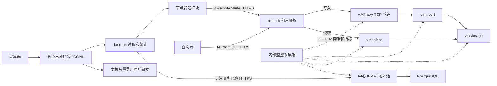

# msMonitor 十万卡集群数据汇总通道详细设计（beta）

## 1. 文档信息

| 项目 | 内容 |
| --- | --- |
| 特性 | msMonitor 十万卡集群数据汇总通道，需求 2 |
| 版本与日期 | 1.1 · 2026-11-24 |
| 交付范围 | 中心 Docker 镜像、K8s 部署和中心侧接口；节点行为在联调用例中验证。 |
| 设计依据 | [主 RFC #63](https://gitcode.com/Ascend/msmonitor/issues/63)、[子 RFC #64](https://gitcode.com/Ascend/msmonitor/issues/64) |
| 文档结构参考 | [vLLM Hook Tracing 特性详细设计](https://gitcode.com/Ascend/msserviceprofiler/blob/master/docs/design/vLLM_Hook_Tracing_Detailed_Design.md) |

## 2. 背景与设计结论

训练节点的原始事件量大。现有采集器将事件写入节点本地 JSONL 并轮转，daemon 增量读取后产生指标、分桶摘要和异常样本。中心通过 Remote Write 汇集数值数据，提供租户读写隔离、横向扩展、故障切换及可观测性。异常需要深挖时，按 rank 和时间窗从节点导出原始证据。

中心采用 VictoriaMetrics Cluster，复用 vmauth 鉴权、HAProxy 分发和 vmselect 查询。I8 用 FastAPI 和 PostgreSQL 提供节点交互。以主 RFC 为准处理原需求的差异。

| 原描述 | 本设计遵从的主 RFC 口径 |
| --- | --- |
| 采集库经批量 IPC 送 sidecar，按类攒批并设双优先级 | 采集器写本地轮转 JSONL，daemon 增量读取。两级队列和批量用于节点上报模块。 |
| 节点代理独立发送 | daemon 调用内置 I3 发送模块，直接使用标准 Remote Write。 |
| 指标、摘要均每 step，可配每 N step | 指标默认每 step，可按 N step 合批并保留每步样本。分桶摘要每 1 分钟墙钟窗口上报，异常实时优先。 |
| 以 20 实例估算十万卡 | 以每节点 8 卡、每作业每节点一路为规划模型，约 12,500 条节点连接。写入后端容量按部署及实测核算，保留至少 50% 写入实例故障余量。 |

## 3. 目标与非目标

### 3.1 目标

- I3 通过统一 HTTPS 入口接收三类数值样本。写入入口仅按 TCP 连接分发。VictoriaMetrics 内部分片沿用产品机制。
- I4 通过 vmselect 提供即时、范围聚合查询及元数据查询。每个租户具有独立读写授权，作业按发送方提供的标签过滤或聚合。
- I5 实现写入后端 HTTP 探活、内部指标抓取、故障期间样本回查及部署故障定位。
- I8 提供注册、心跳、会话持久化及可选身份和运行状态数据。中心副本共享会话，滚动更新兼容旧客户端。
- daemon 负责从节点本地 JSONL 按 rank 和时间窗导出证据。正式十万卡目标按连接、样本、吞吐、活跃时序、聚合查询和故障余量验证。

### 3.2 非目标

- 采集实现、daemon 进程及调度、Activity 统计压缩、可视化和诊断算法由对应工作流负责。
- I8 中心负责创建任务、处理领取与逐 rank 回执、持久化结构化摘要。daemon 负责执行和去重、生成证据并保留待确认批次。业务摘要字段由摘要开发方提供。

## 4. 总体架构

下图展示 K8s 数据路径。单容器部署使用同一套外部 API，内部拓扑见 6.3。

## 5. 关键模块

| 模块 | 职责 | 边界 |
| --- | --- | --- |
| 节点发送（daemon） | 生成 Remote Write 请求，负责攒批、异常优先和待发数据恢复 | 中心测试通过 HTTPS 写入并回查；队列接口和落盘方式由 daemon 实现 |
| vmauth | 按 Token 与 `accountID` 限制完整路径，限制读写权限 | 对外经平台 HTTPS，业务 Token 无权访问内部管理接口 |
| HAProxy | 写入流量按新 TCP 连接轮询，HTTP 探活独立检查后端 | 内部指标端口只给授权监控来源 |
| VMCluster | 写入、存储、查询分别扩容。初始 3 写入、3 存储、2 查询，存储复制因子 2 | 初始资源配置用于部署验证，生产容量需实测 |
| I8 应用与状态库 | 会话、最近有效心跳、身份及遥测扩展持久化 | API 副本无本地业务状态，生产 PostgreSQL 由平台提供 |
| 节点原始证据导出（daemon） | daemon 根据指定 rank 和时间窗读取本地原始记录 | 已轮转的数据可能存在缺口，执行结果应说明缺失范围 |

## 6. 接入链路和异常处理

### 6.1 写入和查询路由

写入与读凭据独立。写路径按租户精确匹配 Remote Write，读路由见第 9 节。对 `label/<name>/values`，标签名匹配 `[a-zA-Z_][a-zA-Z0-9_]*`。合法标签在测试时间窗无匹配值时允许返回成功和空列表。中心不补写或重命名作业标签；独立 ST 使用 `job`，真实联调若发送 `job_name` 则按 `job_name` 查询。

### 6.2 后端故障与重试

K8s 写入池按 `GET /-/healthy` 判断后端健康，业务流量保持 TCP 转发。无健康写入后端时入口就绪失败。daemon 的发送模块在网络错误、429 和 5xx 时保留原批次并退避，永久拒绝独立报告。请求超时可能发生在服务端接收之后，重发沿用原标签、时间戳和值。HTTP 成功和后续可查分别验收。

### 6.3 部署配置约束

单 Docker 由部署人依据模板填写 `center.json` 并准备证书链与私钥 `tls.pem`。统一容器通过 HAProxy 在 8443 终止 TLS，分别转发 I8 和 vmauth；容器内各运行一个 vminsert、vmstorage、vmselect 和 I8 服务，PostgreSQL 与时序数据使用 `/data` 卷。重建测试须复用原卷。I8 Compose 仅用于控制服务实验。

K8s 使用 `center.json` 安装器和平台 Ingress TLS Secret。I8 基础清单为两个副本；启用 `cluster.i8_large_scale` 后生成四副本，每副本 CPU 上限 2 核、数据库池上限 16、Uvicorn 并发上限 1024。写入副本按宿主机分散。目标环境需要 VM Operator、支持 NetworkPolicy 的 CNI、StorageClass、HTTPS 域名与证书、租户凭据和高可用 PostgreSQL。监控配置使用平台现有采集器，按受控命名空间和 Pod 标签放行内部抓取。VM 原生健康和指标共用业务监听端口，采集端仅使用受控账号和信任域，不发布这些端口供外部访问。

## 7. 会话状态与请求关联

### 7.1 注册与心跳字段

| 请求 | 既有字段 | 可选 `metadata` |
| --- | --- | --- |
| 注册 | `daemon_id`、`instance_id` | `job_id`、`run_id`、`node_id`、`daemon_version`、`rank_capabilities`。标识和能力列表有长度及数量限制。 |
| 心跳 | `session_id`、`status_seq`、`collect_state` | `app_version`、`pending_files`、`dropped_records`、`cpu_percent`、`rss_bytes`。各字段独立校验类型和范围。 |

旧请求和响应沿用现有契约。`metadata` 中的身份用于运维关联，授权范围由 Bearer Token 决定。I3 写入 URL 可由平台显式配置。同一注册实例重试返回同一会话。活动会话的重复或较低序号心跳仍返回 200 和 `accepted: true`，数据库状态和 `last_seen` 保持原值。未知或其他 scope 的会话返回 403，已替换的会话返回 409。运维通过数据库视图读取在线状态，距 `last_seen` 达到 60 秒时 `online` 为假。

### 7.2 存储迁移和运维读取

PostgreSQL 通过加法迁移保存注册和心跳的可选信息，迁移在应用启动前执行。保留现有运维视图形态，扩展字段通过内部数据库视图或受控查询获取。心跳遥测只在更高序号携带新值时更新，历史采样状态需能与对应序号区分。指标和日志使用请求类型、状态和请求 ID 排查，避免把 job、节点或 rank 作为无界指标标签。

## 8. 数据输出模式

### 8.1 中心时序数据

I3 发送 Snappy block 压缩的 Protobuf 数值样本，使用毫秒时间戳。普通指标、分桶统计和异常可用同一写入协议；I4 按租户读权限返回 Prometheus 兼容响应。

### 8.2 原始证据与诊断结果

daemon 负责读取和筛选节点本地原始记录。中心通过 I8 指定目标和时间窗，接收证据位置、逐 rank 执行状态及缺失区间。中心时序库只接收数值样本。

## 9. 用户与系统接口

| 能力 | 方法和路径 | 入口 |
| --- | --- | --- |
| I3 写入 | `POST /insert/<accountID>/prometheus/api/v1/write` | 写入 Bearer Token，HTTP 2xx 后按租户查询核对可见性 |
| I4 查询 | `GET /select/<accountID>/prometheus/api/v1/{query,query_range,series,labels,status/buildinfo,label/<name>/values}` | 读 Bearer Token |
| I8 注册 | `POST /api/v1/daemon/register` | 返回 session_id、heartbeat_interval_s（15 秒）；配置 scope 与租户绑定时另返回 HTTPS remote_write_url |
| I8 领取与回报 | `POST /api/v1/daemon/poll-commands`、`POST /api/v1/daemon/ack` | 中心创建逐 rank 的任务键 request_id/version，daemon 执行后回传结果及证据引用 |
| I8 完整结构化摘要 | `POST /api/v1/daemon/submit-summary` | 当前会话、batch_id、schema_version、records；PostgreSQL 提交后确认，同键异内容返回 409 |
| I8 心跳 | `POST /api/v1/daemon/heartbeat` | I8 Bearer Token，成功返回 `accepted: true` |
| I5 运维 | VM `/-/healthy`、`/metrics`，HAProxy `/readyz`、`/livez`、`/metrics`，vmauth 和 I8 内部 `/metrics` | 探活与监控网 |
| 节点导出 | daemon 执行中心下发的导出任务 | 目标 rank、纳秒时间窗 |

I8 运维使用受限数据库凭据通过 `python -m registry enqueue` 创建 `collect`、`stop`、`export` 任务。任务键为 `(scope, daemon_id, request_id, version)`，每个键对应一个目标 rank。`poll-commands` 的 `wait_s` 默认 20，允许 0～20 秒；无任务返回 `command: null`，限流退让时可附 `retry_after_s`。任务确认前可被重复领取。成功导出回执须含 URI 与 SHA-256；相同回执可重试，冲突回执返回 409。

`submit-summary` 接收整数 `schema_version=1`、1～256 个非空记录对象，正文上限 256 KiB。同一 `(scope, daemon_id, batch_id)`、相同记录重试返回 200 和 `persisted: true`，内容冲突返回 409。结构化记录进 PostgreSQL；供 I4 查询的数值摘要另经 I3 写入。逐字段校验和故障用例见 [I8 接口说明](../development_guide/msmonitor_center_control.md)。

## 10. 兼容性和隔离

| 场景 | 行为 |
| --- | --- |
| 旧 daemon 未带 `metadata` | 保持现有请求语义、返回结构和心跳周期 |
| 已有数据库会话 | 先执行幂等加法迁移再滚动应用。旧应用可继续使用原列和视图 |
| 旧 POC 单凭据测试 | 保留既有测试模式。新增隔离实验可使用独立的读写凭据 |
| 跨租户、读写凭据错用 | 入口拒绝，元数据查询也应用相同授权 |
| 同租户多个作业 | 同一租户的读凭据可查询多个作业；作业标签用于筛选，鉴权边界为租户 |
| 日常上报与原始 trace | 日常只发送时序样本。节点有界保留原始文件，独立执行原始证据导出 |

## 11. 性能、安全与可靠性

- **容量**：十万卡约对应 12,500 节点连接、约 9 MB/s 请求体、约 500 万活跃时序的规划模型。按真实样本大小、flush 周期、租户组合和聚合查询并发调整。分别记录入口连接、后端活跃会话、写入速率、时序基数、查询延迟、资源占用与样本可见性。5000+ 现有证据为客户端到单鉴权入口，后端连接另计。
- **故障余量**：以目标载荷下丢失至少一半写入副本时仍承载目标流量为验收。三个副本的半数故障向上取整停两个，或在目标部署采用偶数副本后按一半演练。存储副本故障、平台 VIP 和 PostgreSQL 主备分别验证。
- **可观测性**：监控写入连接与 HTTP 状态、写入吞吐、HAProxy 后端健康与会话、存储磁盘和分片、查询延迟与缓存、I8 请求延迟及数据库连接池等待。复用组件指标，采集器和告警阈值由运行平台确认。
- **安全**：证书校验和 Bearer 授权，Secret 单独下发。租户读写路径精确匹配，监控来源采用命名空间与 Pod 标签联合选择。请求体和连接、数据库等待均有上限。会话和样本载荷不进常规日志。
- **数据可靠性**：队列超限显式报告，训练不因中心不可达无限等待。写入端已确认后的存储安全依赖复制和恢复验证，故障探针按样本值和时间戳核对缺失。

容量校核设写入副本数为 `N`，余量验收时剩余 `R = N - ceil(N / 2)`。用目标拓扑和请求模式测得单个 `vminsert` 可持续的后端连接数与写入吞吐。分别核算 `R × 单实例容量` 能否覆盖目标后端负载，并实测连接偏斜、代理连接复用和查询竞争。入口的 5,100 条连接结果保留为有条件的 POC 证据。

## 12. 验证设计

### 12.1 单元和回归验证

- I4 对两个租户写入带不同 `job` 的样本，验证第 9 节的全部读路由，覆盖版本信息、标签值、跨租户、无凭据及读写凭据错用。
- I5 校验 HAProxy 配置，验证后端端口可连但 HTTP 健康失败时会被摘流，恢复后重新接收连接。验证指标可见，未授权来源无法访问。
- I8 验证旧契约、数据迁移、扩展字段输入限制、重复注册、心跳乱序、跨范围、实例替换和恢复。已有两副本与状态库故障实验持续回归。
- 节点发送的持久队列和调度由 daemon 侧测试。本地原始数据筛选由 daemon 测试覆盖。接收端拒绝或断网复测，按样本回查确认恢复。

### 12.2 Linux 和目标集群验证

| 验证 | 做法 | 通过条件 |
| --- | --- | --- |
| Linux 中心独立验证 | 统一镜像验证 HTTPS、I3/I4/I8 与同卷重建；分别用 I5 后端健康实验和 I8 双副本 Compose 验证故障 | 六类读路由及租户隔离符合预期，同卷重建后历史数据可查；多后端摘流、跨副本会话按各自拓扑验收 |
| 规模与故障 | 目标 K8s 进行预检和安全发布。按 12,500 路、业务分布及真实聚合查询发压，注入写入副本退出和存储故障 | 取得故障前、中、后连接与吞吐指标，按测试窗口核对数据。单个 `vminsert` 的 5000+ 连接如作为验收项单独取证 |
| 真实 daemon 联调 | 核对部署下发 URL、CA、账号与三类指标。检验每 step 或每 N step 合批、1 分钟摘要、异常优先、断网重启和原始 trace 节点保留 | 样本值、时间戳、标签和上报周期一致，恢复后可用已留存样本全部查回，异常与缺口可定位 |
| 真实训练链路 | 按主 RFC 用目标小规模作业联动采集、daemon、中心与消费方 | 节点产生 JSONL，中心可查回各读接口所需指标，训练开销和数据质量由实际负载验证 |

容量用例分开记录三个指标。I8 用 12,500 个模拟节点并发注册、心跳和领任务。I3 的 M5 用例在两轮相同的 1,200 万时序写入期间叠加 30,000 个客户端，检查重叠区间和回查完整性。9 MB/s 单独按稳态请求体字节数核验。运行命令、环境前提和故障注入步骤见[中心独立验收](../development_guide/msmonitor_center_acceptance.md)。

### 12.3 daemon 联调清单

| 联调项 | daemon 侧准备 | 中心侧核对 |
| --- | --- | --- |
| 接入与租户 | 配置写入 URL、写凭据、I8 URL、I8 凭据及 CA | HTTPS 和证书校验成功。I3 读写租户与 I8 授权范围匹配 |
| 指标契约 | 提供同一作业的 step 指标、分桶摘要、异常样例，确认标签、时间戳、单位及 `job` | 按毫秒时间戳、标签和值回查。元数据可列出同租户多个作业 |
| 上报节奏 | 提供默认每 step、每 N step 合批、至少两个 1 分钟摘要窗口及一个异常触发 | 合批保留各 step 样本，摘要与墙钟窗口一致，记录异常触发到可查的时延 |
| 发送恢复 | 限时断开写入，在积压期重启 daemon，再恢复入口 | 对照预期样本，确认已入队批次补齐。核对超限、永久拒绝和重复投递的记录 |
| I8 会话 | 首次注册、同实例重试、重启后重新注册、发送新旧序号心跳及可选元数据 | 确认会话切换、旧实例拒绝、元数据持久化和离线状态 |
| 原始数据 | 运行期间检查本地 JSONL 与轮转配置，选择两个 rank 做一次本地证据导出 | I3 收到数值样本，I8 可收到证据引用；节点导出按指定时间窗生成证据及缺口清单 |

## 13. 评审需确认事项

1. 平台确定生产域名与凭据签发、Gateway 网络范围、监控采集器来源以及高可用 PostgreSQL 的交付方式。
2. daemon 侧确认扩展字段、业务样例、队列风控及恢复验收时长。训练指标的字段定版后复核基数和容量口径。
3. 确认原条款的 5000+ 连接对应鉴权入口还是单个后端，并定义持续压测时长、聚合查询负载和故障期间可接受延迟。
4. 平台为控制 scope 绑定租户并分发凭据；daemon 使用稳定的任务键和批次键重试。真实业务摘要样例及证据位置在联调时核对。

## 14. 回滚

先停止发布新增查询或监控配置，按 Git 差异回退 vmauth 读路由、HAProxy 配置与内部抓取规则，并滚动恢复。I8 回退应用镜像时保留数据库附加列和兼容视图，旧客户端契约继续可用。保存查询样本、组件配置和变更日志，回滚后用同租户样本重新验证写入、查询和注册心跳。存储 PVC 与排障证据按平台留存策略处理。
