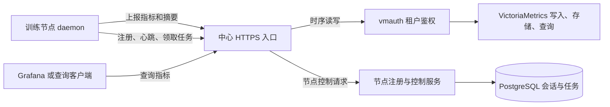

# 部署 msMonitor 中心（beta）

训练节点上的 daemon 将指标和摘要发到中心，并向中心注册、发送心跳、领取任务。部署人只需给训练节点一个可访问的 HTTPS 入口。查询端通过同一入口读取本租户的数据。



单机联调选**单 Docker**，图中的中心组件随一个容器启动。集群部署选 **Kubernetes**，时序组件和控制服务分开部署。以下命令均在 Linux 的仓库根目录用 Bash 执行。

Kubernetes 完整安装读取 `center.json`，默认时序保留期为 `7d`；只部署时序读写时使用[独立 YAML 与预检](msmonitor_center_metrics.md)，模板保留期为 `1d`。

## 先生成中心配置和 Token

在 Linux 上准备 Docker、Python 3、OpenSSL 和 curl，并进入与镜像版本对应的仓库根目录。下面的命令从模板生成 `center.json`，并分别生成写入、读取和控制 Token。已有配置时会保留原文件。

```bash
STATE="$HOME/msmonitor-center"
install -d -m 0700 "$STATE"
install -d -m 0755 "$STATE/config"
(
  umask 077
  python3 - "$STATE/config/center.json" <<'PY'
import json
import secrets
import sys
from pathlib import Path

out = Path(sys.argv[1])
cfg = json.loads(Path("deploy/center/center.json.example").read_text(encoding="utf-8"))
for role in ("write_token", "read_token"):
    cfg["tenants"]["10"][role] = secrets.token_hex(32)
cfg["i8_tokens"]["demo-job"] = secrets.token_hex(32)
try:
    with out.open("x", encoding="utf-8") as f:
        json.dump(cfg, f, indent=2)
        f.write("\n")
except FileExistsError:
    print(f"Using existing configuration: {out}")
PY
)
```

模板使用租户 `10` 和控制范围 `demo-job`，下文命令沿用这两个值。新增租户或控制范围时，可运行 `openssl rand -hex 32` 生成新的 Token，每个用途分别生成。中心注册响应可返回写入 URL，凭据由部署方下发。

需要在同一个容器中启动中心和 Grafana 时，按[带看板的单镜像部署说明](../../../deploy/center/grafana/README.md)执行。

## 方式一：单 Docker

**1. 选择镜像和端口。** 准备训练节点能访问的中心服务器 IPv4，以及匹配访问地址的服务器证书链和私钥。用域名访问时，证书应包含该域名；直接用 IP 访问时，证书应包含该 IP。以下是首次部署示例。

```bash
STATE="$HOME/msmonitor-center"
install -d -m 0700 "$STATE"
install -d -m 0755 "$STATE/config"

# 首次创建。把示例 IP、镜像名和证书路径改成本机实际值。
( set -C; cat > "$STATE/center.env" <<'ENV'
CENTER_IP=192.0.2.10
CENTER_PORT=8443
CENTER_IMAGE=msmonitor-center:local
CERT_CHAIN=/path/to/server-chain.pem
CERT_KEY=/path/to/server.key
ENV
)
vi "$STATE/center.env"
source "$STATE/center.env"
```

收到预构建镜像归档时，先执行 `docker load -i /实际路径/msmonitor-center.tar`，将输出的镜像名填到 `CENTER_IMAGE`。使用镜像仓库时，先执行 `docker pull "$CENTER_IMAGE"`。需要从源码构建时，执行 `docker build -t "$CENTER_IMAGE" deploy/center/control`。

发布验收和交付请使用同一镜像 digest。源码联网构建按 `requirements.txt` 的版本下限解析，重建可能选择不同版本。离线安装 Python 依赖时，将目标架构和 Python 版本对应的全部 wheel（含间接依赖）放入 `deploy/center/control/wheelhouse/`，构建会使用 `--no-index`。发布方应归档 wheel 及 SHA-256 清单，重建前校验。完整镜像的重建还依赖相同的基础镜像及系统软件包。

**2. 准备 HTTPS 证书。** 如果已有中心服务器证书链和私钥，按第 1 步填写的路径执行以下命令。若用私有 CA，另向签发方获取 CA 公共证书，供客户端使用。

```bash
test -s "$CERT_CHAIN" && test -s "$CERT_KEY" &&
( set -C; cat "$CERT_CHAIN" "$CERT_KEY" > "$STATE/config/tls.pem" ) &&
chmod 0644 "$STATE/config/center.json" "$STATE/config/tls.pem"
```

首次联调也可使用下面的命令生成测试证书。它与上面的证书准备命令二选一。以下示例假设客户端直接使用 `CENTER_IP` 访问，客户端需显式信任生成的 `test-ca.pem`。

```bash
(
  set -euo pipefail
  umask 077
  test ! -e "$STATE/config/tls.pem"
  test ! -e "$STATE/test-ca.pem"
  test ! -e "$STATE/test-server.key"
  openssl req -x509 -newkey rsa:2048 -nodes -days 7 \
    -subj "/CN=$CENTER_IP" -addext "subjectAltName=IP:$CENTER_IP" \
    -keyout "$STATE/test-server.key" -out "$STATE/test-ca.pem"
  cat "$STATE/test-ca.pem" "$STATE/test-server.key" > "$STATE/config/tls.pem"
  chmod 0644 "$STATE/config/center.json" "$STATE/config/tls.pem"
)
```

**3. 启动并检查。** `--publish` 的左侧是宿主机 IP 和上报端口，右侧 `8443` 是容器内端口。再次查询直到状态为 `healthy`，启动异常时查看容器日志。

```bash
docker run -d --name msmonitor-center --restart unless-stopped --stop-timeout 45 \
  --publish "$CENTER_IP:$CENTER_PORT:8443" \
  --mount "type=bind,src=$STATE/config,dst=/etc/msmonitor,readonly" \
  --mount type=volume,src=msmonitor-center-data,dst=/data \
  "$CENTER_IMAGE"
docker port msmonitor-center 8443/tcp
docker inspect --format '{{.State.Health.Status}}' msmonitor-center
docker logs --tail 30 msmonitor-center
```

**端口已占用怎么办？** 修改 **`$HOME/msmonitor-center/center.env` 的 `CENTER_PORT`**（例如 `18443`），重新执行 `source "$STATE/center.env"`。Docker 在创建容器时绑定端口；若首次启动失败且留下同名容器，确认它是本次创建的、状态为 `created` 后，执行 `docker rm msmonitor-center`，再执行第 3 步。已有运行实例要改端口时，安排停机并用原数据卷重建，再更新训练节点的地址。

## 方式二：Kubernetes 完整中心

准备可用的 kubectl context、目标命名空间、VictoriaMetrics Operator、Ingress Controller、StorageClass 或对应持久卷，以及 PostgreSQL。平台需提供镜像仓库地址、可访问的 HTTPS 域名、目标命名空间中的 TLS Secret 和数据库连接串。

1. 复制前面生成的 `center.json`，设置 `cluster` 中的实际值。已有 K8s 配置时，沿用已有文件。
2. 将可由集群节点拉取的完整镜像地址填入 `cluster.image`。已有发布镜像可直接使用。自行构建时，先执行 `docker build -t "$IMAGE" deploy/center/control && docker push "$IMAGE"`，其中 `IMAGE` 为有推送权限的仓库地址和版本标签。
3. 按以下顺序执行。两个连接串文件各填一行，运行账号用于读写状态，迁移账号需能创建表。预检通过后正式安装。

```bash
KCFG="$HOME/msmonitor-center-k8s"
CTX="$(kubectl config current-context)"
install -d -m 0700 "$KCFG"
umask 077
cp -n "$STATE/config/center.json" "$KCFG/center.json"
vi "$KCFG/center.json"
vi "$KCFG/database-url" "$KCFG/migration-database-url"
python3 deploy/center/control/install_k8s.py --config "$KCFG/center.json" --context "$CTX" --check &&
python3 deploy/center/control/install_k8s.py --config "$KCFG/center.json" --context "$CTX"
```

正式安装命令自动执行迁移、授权和运行账号权限检查。两个连接串须指向同一数据库。迁移账号需拥有中心 schema 和表或具备相应授权权利；安装器授予运行账号 schema 的 USAGE、会话表的读写、任务表的读取及更新、摘要表的读取及插入权限。授权或验证失败时安装在发布工作负载前停止。默认三个存储 Pod 需要三个可调度的宿主机拓扑域。

训练节点使用 `cluster.host` 对应的 Ingress HTTPS 地址。外部端口由平台的 Ingress Controller Service 或负载均衡器配置，通常是 `443`。自定义端口时请记录平台实际暴露的端口。完整安装已包含时序读写；若只需这部分，可按[时序组件独立部署说明](msmonitor_center_metrics.md)直接配置 YAML，该模板默认保留 `1d`。

## 部署完交给训练节点什么

记录**中心宿主机 IP（K8s 为入口地址）、证书匹配的访问域名或 IP、实际 HTTPS 端口、租户编号**。例如宿主机 IP 为 `192.0.2.10`，证书包含此 IP，外部端口为 `18443`，则交付以下信息：

| 接收方 | 要配置的地址 | 随地址提供 |
| --- | --- | --- |
| daemon 上报指标 | `https://192.0.2.10:18443/insert/10/prometheus/api/v1/write` | 租户 10 的写 Token |
| daemon 注册、心跳和领任务 | 中心地址 `https://192.0.2.10:18443`，例如注册路径为 `/api/v1/daemon/register` | 对应作业范围的控制 Token |
| Grafana 等查询端 | `https://192.0.2.10:18443/select/10/prometheus` | 租户 10 的读 Token |

### 为训练作业准备凭据文件

在中心宿主机执行以下命令。单 Docker 使用默认路径。Kubernetes 部署先把 `CONF` 改为实际安装使用的 `center.json`。启用了外部 vmauth Secret 时，读写 Token 以平台实际配置为准。

```bash
CONF="$STATE/config/center.json"
(
  umask 077
  out=$(mktemp -d "$STATE/client-credentials.XXXXXX") || exit 1
  python3 - "$CONF" "$out" <<'PY'
import json
import sys
from pathlib import Path

cfg = json.loads(Path(sys.argv[1]).read_text(encoding="utf-8"))
out = Path(sys.argv[2])
for name, token in {
    "write.token": cfg["tenants"]["10"]["write_token"],
    "read.token": cfg["tenants"]["10"]["read_token"],
    "control.token": cfg["i8_tokens"]["demo-job"],
}.items():
    if not isinstance(token, str) or token.startswith("REPLACE_"):
        raise SystemExit(f"{name}: expected a single configured token")
    (out / name).write_text(token + "\n", encoding="utf-8")
print(f"Credentials directory: {out}")
PY
)
```

把 `write.token` 和 `control.token` 放进作业调度器的 Secret，提交一次作业时挂载给每个节点的 daemon。把 `read.token` 单独交给查询端。完整的 `center.json`、服务端私钥和含私钥的 `tls.pem` 都留在中心。若使用测试自签证书或客户端尚未信任的私有 CA，另外下发公共证书，例如上面生成的 `test-ca.pem`，并配置到 daemon 使用的信任库或 CA 文件。

### 从训练节点检查接入

在 daemon 实际运行的环境里执行，替换 `ORIGIN` 和 `CONTROL_TOKEN_FILE`。使用系统已信任的证书时，保持 `tls=()`。需要额外 CA 时，取消对应行的注释。

```bash
ORIGIN='https://192.0.2.10:8443'
CONTROL_TOKEN_FILE='/实际挂载路径/control.token'
tls=()
# tls=(--cacert /实际挂载路径/center-ca.pem)

# 无 Token 时预期 HTTP 401，表示 HTTPS 校验通过且中心已响应。
curl "${tls[@]}" -sS --connect-timeout 5 --max-time 10 \
  -o /dev/null -w 'HTTP %{http_code}\n' \
  -H 'Content-Type: application/json' -d '{}' \
  "$ORIGIN/api/v1/daemon/register"

# 带控制 Token，预期 HTTP 200 并返回 session_id。
# 测试使用独立 daemon_id，避免替换真实作业的会话。
probe_id="readme-probe-$(openssl rand -hex 8)"
printf 'Authorization: Bearer %s\n' "$(cat "$CONTROL_TOKEN_FILE")" |
  curl "${tls[@]}" -fsS --connect-timeout 5 --max-time 10 \
    -H @- -H 'Content-Type: application/json' \
    -d "{\"daemon_id\":\"$probe_id\",\"instance_id\":\"smoke\"}" \
    "$ORIGIN/api/v1/daemon/register"
```

这一步验证 HTTPS 和控制 Token。Remote Write、指标回查以及租户隔离可按[中心验收说明](../development_guide/msmonitor_center_test.md)执行。

## 常用配置

| 配置位置 | 参数 | 效果 |
| --- | --- | --- |
| Docker：`center.env` | `CENTER_IP`、`CENTER_PORT` | 选择宿主机监听网卡和外部端口。示例默认端口为 8443。 |
| Docker：启动命令 | `msmonitor-center-data:/data`（命名卷） | 保存时序数据和会话。重建时复用原卷，每个卷供一个中心实例使用。 |
| `center.json` | `tenants`、`i8_tokens` | 分别设置每租户的读写凭据和每个控制范围的凭据。 |
| `center.json` | `retention_period` | 完整中心默认保留 7 天时序数据，如 `30d` 表示 30 天。 |
| `center.json` | `public_write_origin`、`scope_accounts` | 可选。绑定控制范围与租户后，注册响应会返回对应写入 URL。入口端口变化时同步更新 origin。 |
| K8s：`center.json` 的 `cluster` | `host`、`tls_secret`、`ingress_class`、`gateway_namespace`、`gateway_pod_labels` | 选择 HTTPS 域名、证书、Ingress 控制器及允许访问中心的网关来源。 |
| 同上 | `storage_class`、`vmstorage_memory` | 选择持久卷类型及存储 Pod 内存请求和上限。省略时使用集群默认 StorageClass 和模板内存规格。 |
| 同上 | `i8_large_scale` | 启用后生成 4 个控制服务副本，每副本 CPU 上限 2 核、数据库池上限 16、并发上限 1024。滚动升级需额外预留数据库连接。 |
| 同上 | `external_vmauth_secret` | 默认由安装器生成时序读写鉴权 Secret。设为 `true` 时，平台预先维护 `msmonitor-i3-auth` 并负责凭据轮转。 |

完整的注册、写入、回查与租户隔离验证见[中心验收说明](../development_guide/msmonitor_center_test.md)。
